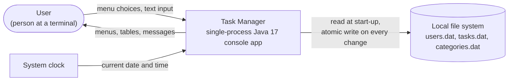
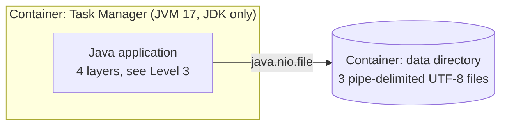
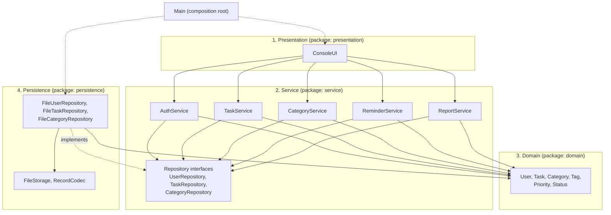
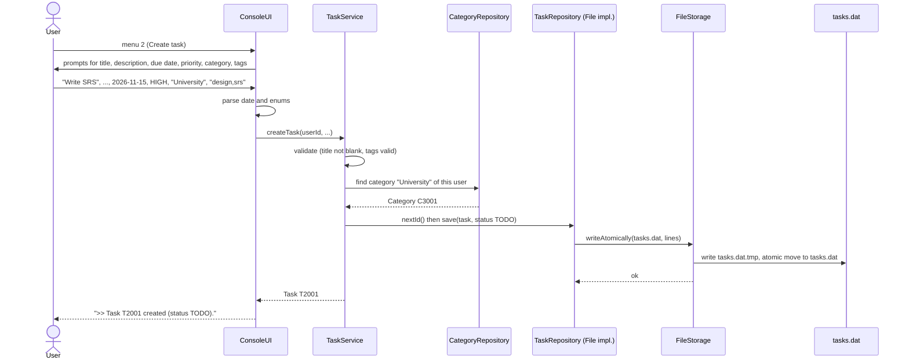
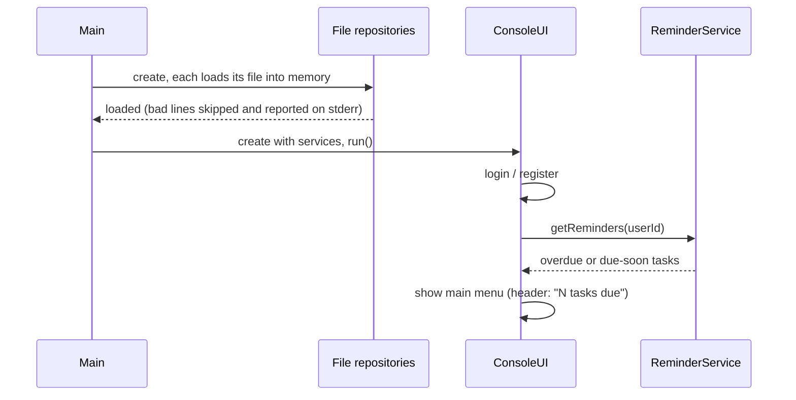

# Architecture — Task Manager

- **Specification reference:** `SRS-TM-001` (Sections 2.1, 2.5, 4, 7), activity diagram (swimlanes)
- **Companion documents:** [`class-diagram.md`](./class-diagram.md) (classes), [`data-model.md`](./data-model.md) (stored data)
- **Documentation template:** **C4 model** (Context → Containers → Components), plus a layered view, a runtime view, and short decision records. C4 is a well-known template that goes from the big picture down to the parts, and each level answers one question. The class diagram is the next level down (C4 "Code").

---

## 1. Three questions this document answers

| Question | Answer |
|---|---|
| Which part deals with the user? | **Presentation layer**: `ConsoleUI` only. |
| Where are the business rules checked? | **Service layer** (ownership, validation, uniqueness) and **Domain layer** (status workflow, `completedAt` rule). Never in the UI or in the files layer. |
| Which part reads and writes the data? | **Persistence layer**: `File*Repository` through `FileStorage`. |

---

## 2. Level 1 — System context

Who and what is around the system?



| Element | Role |
|---|---|
| User | The only human actor (SRS 3.2). |
| Local file system | Supporting actor; the only storage. No database, no network (SRS 2.5, 5.3). |
| System clock | Provides `LocalDate.now()` / `LocalDateTime.now()` for due dates, overdue checks and `completedAt`. |

> The SRS lists a "Scheduler" as an actor that triggers reminders. In the implementation there is **no scheduler thread**: `ConsoleUI` calls `ReminderService` after login and at the start of each main-menu cycle. The scheduler is therefore the clock plus this call, not a separate component.

---

## 3. Level 2 — Containers

The application is **one process** (one JVM) with no server and no external service, so there is a single runtime container plus its data store.



| Container | Technology | Responsibility |
|---|---|---|
| Task Manager | Java SE 17, JDK class library only | All behaviour: UI, rules, persistence logic. |
| Data directory | Plain text files | Durable storage. Layout in `data-model.md`. |

Constraints that shape everything below (SRS 2.5): **no frameworks, no third-party libraries, no database, no GUI framework.**

---

## 4. Level 3 — Components and layers



### 4.1 Responsibilities

| Layer | Components | Responsibility | Does **not** do |
|---|---|---|---|
| Presentation | `ConsoleUI` | Menus, reading and parsing input, tables, error messages, holds the logged-in user, triggers reminders | Business rules, file access |
| Service | `AuthService`, `TaskService`, `CategoryService`, `ReminderService`, `ReportService` | Use-case logic, validation, ownership checks, search/filter/sort, statistics | Printing, reading the console, file I/O |
| Domain | `User`, `Task`, `Category`, `Tag`, `Priority`, `Status` | The data of the problem and the invariants of one object (legal status change, `completedAt` rule) | Knowing about files or the UI |
| Persistence | `File*Repository`, `FileStorage`, `RecordCodec` | Load, save, text format, escaping, atomic write, skipping bad lines | Business decisions |
| Composition root | `Main` | Creates repositories, services and the UI, and wires them together | Any logic |

### 4.2 Dependency rules

1. Dependencies point **inward**: Presentation → Service → Domain. Nothing points up.
2. **Dependency inversion:** services depend on repository **interfaces**, never on `File*Repository`. The implementations depend on the interfaces, so storage can be replaced without touching service or UI code (NFR-09).
3. The domain depends on nothing except the JDK.
4. `Main` is the only place that knows both the interfaces and their file-based implementations.
5. Services receive a `java.time.Clock` (default `Clock.systemDefaultZone()`), so due-date and reminder logic can be tested with a fixed date.

### 4.3 Package layout

```text
taskmanager/
├── Main.java
├── presentation/   ConsoleUI
├── service/        AuthService, TaskService, CategoryService,
│                   ReminderService, ReportService,
│                   TaskFilter, TaskSort, DueFilter, SortField,
│                   UserRepository, TaskRepository, CategoryRepository,
│                   ValidationException, StorageException
├── domain/         User, Task, Category, Tag, Priority, Status
└── persistence/    FileUserRepository, FileTaskRepository,
                    FileCategoryRepository, FileStorage, RecordCodec
```

---

## 5. Runtime view — user story "Create a task" (UC-03) with an error case

**Story:** *As a user I want to create a task so that I do not forget it.*



| Step | Component | Data read | Data changed |
|---|---|---|---|
| Parse input | `ConsoleUI` | – | – |
| Validate, find category | `TaskService`, `CategoryRepository` | `categories.dat` (cached) | – |
| Build task, new id | `TaskService`, `TaskRepository` | `next-id` counter | counter + 1 |
| Save | `FileTaskRepository`, `FileStorage` | – | new line in `tasks.dat` |

### Error cases

| Case | Detected by | Result |
|---|---|---|
| Invalid date or priority text | `ConsoleUI` (parsing) | Message with the expected format, re-prompt (UC-03 flow 4a). |
| Blank title, unknown category | `TaskService` | `ValidationException`, message shown, no data changed (UC-03 flow 4a). |
| Disk write fails | `FileStorage` → `StorageException` | Message shown; the old file is still intact because writing uses a temp file first; user may retry (UC-03 flow 7a). |
| Any unexpected `RuntimeException` | `ConsoleUI.handleError` (top-level loop) | Generic message, back to the menu, program keeps running (NFR-07). |

---

## 6. Runtime view — start-up



All data is loaded into memory once and kept in a map per repository. Reads never touch the disk; every change rewrites the affected file atomically. This is what makes NFR-01 (500 ms) and NFR-02 (2 s for 10 000 tasks) realistic.

---

## 7. Cross-cutting concerns

| Concern | Decision | Where |
|---|---|---|
| Error handling | Services throw `ValidationException` / `StorageException`; only `ConsoleUI` turns them into text | Presentation |
| Crash safety (NFR-03) | Write `<file>.tmp`, then `Files.move(..., ATOMIC_MOVE)` | `FileStorage` |
| Security (NFR-04) | Random salt per user, SHA-256 via `MessageDigest`, generic "invalid credentials" message | `AuthService` |
| Ownership (Rule 6.3.1) | Every service method takes `userId` and checks `task.userId` | Service |
| Testability (NFR-06) | Services are usable without the console; repositories and `Clock` can be replaced in tests | Service, `Main` |
| Portability (NFR-05) | Only `java.nio.file` and `java.time`; no OS-specific paths | All |

---

## 8. Architecture decisions

| # | Decision | Reason | Alternative rejected |
|---|---|---|---|
| D1 | Layered architecture with repository interfaces | Simple, fits a small team and the SRS; meets NFR-06 and NFR-09 | Single class or UI mixed with logic: not testable |
| D2 | Load all data into memory, write the whole file on each change | Simple and fast enough for 10 000 tasks; whole-file atomic write is easy to make crash-safe | Append-only or in-place edits: harder to keep consistent |
| D3 | Services take `userId` as a parameter instead of reading a global session | Keeps services free of UI state and easy to test | Static "current user" |
| D4 | Business rules that concern one object live in the domain (`Task`, `Status`) | One place for the rule, cannot be bypassed by a service | Rules duplicated in services |
| D5 | Plain-text pipe format with an escape rule | Required by the SRS (no database, no libraries) | JSON/XML: needs a library or a custom parser |
| D6 | No scheduler thread; reminders are checked on login and on each menu cycle | Single-threaded, no concurrency problems, matches SRS UC-06 | Background timer thread |

---

## 9. Requirement traceability

| Requirement | Architectural element |
|---|---|
| FR-01 – FR-03 | `AuthService`, `UserRepository`, session in `ConsoleUI` |
| FR-04 – FR-11 | `TaskService`, `Task`, `Status`, `TaskRepository` |
| FR-12 | `CategoryService`, `CategoryRepository` |
| FR-14 | `ReminderService`, call from `ConsoleUI` |
| FR-15 | `ReportService` |
| FR-16, NFR-07 | `ValidationException`, top-level handler in `ConsoleUI` |
| FR-17, NFR-03 | `File*Repository`, `FileStorage` |
| NFR-01, NFR-02 | In-memory caches in the repositories (D2) |
| NFR-04 | `AuthService` |
| NFR-05 | JDK-only code (Section 7) |
| NFR-06, NFR-09 | Layer rules and repository interfaces (Section 4.2) |

---

## 10. Contradictions found and fixed

| # | Where | Contradiction | Resolution |
|---|---|---|---|
| 1 | SRS 2.1 / 7: "each layer depends only on the layer below" | The service layer also uses the domain **and** repository interfaces, the presentation layer displays domain objects, and persistence depends on the domain. This is not a strict "only the layer below" stack. | Described accurately as dependencies pointing inward with dependency inversion (Section 4.2). The SRS sentence should be reworded. |
| 2 | SRS 2.1 / 7: repository interfaces drawn inside the persistence layer | If the interfaces belong to persistence, the service layer would depend on persistence, which defeats NFR-09. | The interfaces are placed in the **service** package; only their implementations are in persistence. |
| 3 | SRS 3.2 / activity diagram: "Scheduler / System Clock" actor and "File System" swimlane | They are drawn like components, but no scheduler or file-system component exists in the code. | The scheduler is the clock plus a call from `ConsoleUI`; the file system is an external element accessed through `FileStorage` (Section 2). |
| 4 | SRS 7 service list | `CategoryService` and the category repository are missing although FR-12 and `categories.dat` exist. | Added (also in `class-diagram.md`). |
| 5 | Class diagram in SRS (`ConsoleUI` holds `main`) vs. a composition root | The UI class both started the program and used the services, so it would have to create the repositories and break the layer rule. | Added `Main` as composition root. |
| 6 | SRS 6.3 Rule 5 vs. activity diagram | The SRS says malformed lines are "reported"; the activity diagram says "logged to stderr". | Reported on stderr (Section 6). |

---

## 11. Open points for the team

1. Do we want `Main` in the default package or in `taskmanager`? This document assumes `taskmanager`.
2. Should the data directory path be a command-line argument or a fixed folder (for example `./data`)? Not specified in the SRS.
