# نمودار فعالیت (Activity Diagram) — چرخهٔ عمر وظایف و جریان تغییر وضعیت

- **اولویت مستندسازی:** اولویت ۳ (چرخهٔ عمر وظیفه از ایجاد تا تکمیل نهایی)
- **مرجع سند نیازمندی‌ها:** `SRS-TM-001` (بخش‌های `UC-01` تا `UC-06`، نیازمندی‌های `FR-01` تا `FR-18`، الزامات `NFR-03`، `NFR-07` و بخش ۶.۳)

---

## ۱. هدف و نمای کلی
نمودار فعالیت (Activity Diagram) توالی اجرای رفتارها، مسیرهای کنترلی، شاخه‌های تصمیم‌گیری و سازوکار ذخیره‌سازی داده را در سامانه مدیریت وظایف کنسولی مدل‌سازی می‌کند. این مستند به ۴ پرسش کلیدی معماری پاسخ می‌دهد:
۱. **جریان اجرای فرآیند:** چگونگی دریافت دستورات از واسط کنسول (`ConsoleUI`)، پردازش در لایه سرویس (`TaskService`) و ارتباط با موجودیت‌های دامنه بدون نیاز به فریم‌ورک‌های خارجی.
۲. **اعتبارسنجی ورودی و پایداری (`NFR-07`):** چگونگی به دام انداختن ورودی‌های نامعتبر کاربر توسط اعتبارسنج‌ها و دریافت مجدد ورودی بدون توقف یا خروج ناگهانی برنامه.
۳. **مدیریت چرخهٔ عمر تسک (`UC-03`, `UC-05`):** فرآیند انتقال وظیفه از وضعیت اولیه (`TODO`) به وضعیت‌های پایانی (`DONE` یا `CANCELLED`) همراه با رعایت قیود یکپارچگی داده (قاعده ۶.۳.۳).
۴. **ذخیره‌سازی اتمیک و مقاوم در برابر خرابی (`NFR-03`):** سازوکار نوشتن امن روی فایل متنی دیسک (`tasks.dat`) با استفاده از فایل موقت و جابه‌جایی اتمیک.

---

## ۲. نمودار جامع فعالیت (Master Activity Diagram)

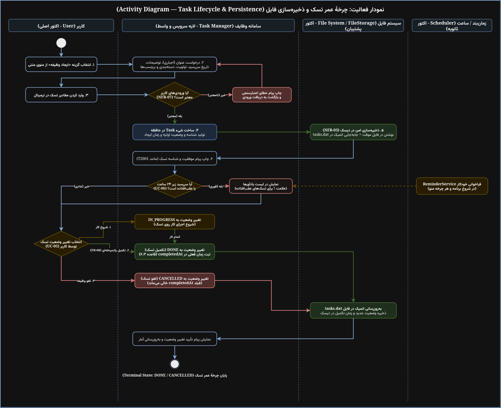

*(فایل سورس و قابل ویرایش در [`task-manager-activity.drawio`](./task-manager-activity.drawio) موجود است)*

---

## ۳. معماری ستون‌ها (Swimlanes) و تفکیک وظایف

مطابق با بخش ۳.۲ سند نیازمندی‌ها (`SRS-TM-001`)، سیستم تک‌کاربره بوده و مسئولیت‌ها به ۴ ستون تفکیک شده‌اند:

| ستون (Swimlane) | نوع جزء / اکتور | مسئولیت معماری |
|:---|:---|:---|
| **کاربر (User)** | اکتور اصلی (Primary) | تعامل با ترمینال متنی، انتخاب شماره گزینه‌های منو، ورود فیلدها و تأیید عملیات‌های حساس (مثل حذف). |
| **سامانه وظایف (Task Manager)** | هستهٔ نرم‌افزار (`ConsoleUI`, لایه Service) | پارس کردن رشته‌های متنی، اعتبارسنجی فرمت ورودی‌ها، اعمال منطق‌های تجاری و فراخوانی مخزن‌ها (Repositories). |
| **سیستم فایل (`FileStorage`)** | اکتور پشتیبان (Supporting) | مدیریت خواندن و نوشتن اتمیک فایل‌های داده (`tasks.dat`, `users.dat`, `categories.dat`) بدون آسیب دیدن داده هنگام قطعی برق (`NFR-03`). |
| **زمان‌بند / ساعت سیستم (Scheduler)** | اکتور ثانویه (Secondary) | فراخوانی خودکار سرویس یادآوری (`ReminderService`) در زمان بالا آمدن برنامه و در هر چرخه بازگشت به منوی اصلی (`UC-06`). |

---

## ۴. چرخه وضعیت تسک و قوانین یکپارچگی داده

### ۴.۱ معماری ماشین وضعیت وظایف
چرخه حیات هر تسک تحت کنترل یک ماشین وضعیت متناهی (FSM) با مسیرهای مشخص، امکان تکمیل میان‌بر و وضعیت‌های پایانی بازگشت‌ناپذیر است:
┌────────────────────────┐
              │       [نقطه شروع]      │
              │    ایجاد وظیفه (UC-03) │
              └───────────┬────────────┘
                          │
                          ▼
                   ┌─────────────┐
                   │    TODO     │
                   └──────┬──────┘
                          │
        ┌─────────────────┼─────────────────┐
        │                 │                 │
  (۱) شروع کار     (۲) تکمیل مستقیم   (۳) لغو تسک
        │              (FR-08)              │
        ▼                 │                 ▼
 ┌─────────────┐          │          ┌─────────────┐
 │ IN_PROGRESS │          │          │  CANCELLED  │ ◄── [وضعیت پایانی]
 └──────┬──────┘          │          └─────────────┘     (completedAt = null)
        │                 │                 ▲
        ├─────────────────┼─────────────────┘
        │                 │            (۵) توقف کار
 (۴) پایان کار            │
        │                 │
        ▼                 ▼
 ┌─────────────────────────────────────────┐
 │                  DONE                   │ ◄── [وضعیت پایانی]
 │ (completedAt = زمان دقیق تکمیل)         │
 └─────────────────────────────────────────┘
---

### ۴.۲ ماتریس انتقال وضعیت‌ها

| وضعیت مبدأ | مقصد: `TODO` | مقصد: `IN_PROGRESS` | مقصد: `DONE` | مقصد: `CANCELLED` |
|:---|:---:|:---:|:---:|:---:|
| **`TODO`** | *نامعتبر (یکسان)* | **مجاز** (مسیر ۱) | **مجاز** (مسیر ۲، `FR-08`) | **مجاز** (مسیر ۳) |
| **`IN_PROGRESS`** | غیرمجاز (خطای `2a`) | *نامعتبر (یکسان)* | **مجاز** (مسیر ۴) | **مجاز** (مسیر ۵) |
| **`DONE`** | غیرمجاز (خطای `2a`) | غیرمجاز (خطای `2a`) | *نامعتبر (یکسان)* | غیرمجاز (خطای `2a`) |
| **`CANCELLED`** | غیرمجاز (خطای `2a`) | غیرمجاز (خطای `2a`) | غیرمجاز (خطای `2a`) | *نامعتبر (یکسان)* |

---

### ۴.۳ تشریح مسیرهای انتقال و معناشناسی سیستم

۱. **مسیر ۱: `TODO → IN_PROGRESS` (شروع اجرای تسک)**
   - **نحوه تحریک:** کاربر از گزینه تغییر وضعیت منو، وضعیت `IN_PROGRESS` را انتخاب می‌کند.
   - **قانون:** فیلد `completedAt` همچنان مقدار `null` باقی می‌ماند.
   - **پیامد:** تسک از صف انتظار وارد مرحله اجرا می‌شود و تغییرات فوراً در `tasks.dat` ذخیره می‌گردد.

۲. **مسیر ۲: `TODO → DONE` (تکمیل یک‌مرحله‌ای — `FR-08`)**
   - **نحوه تحریک:** کاربر تسک را بدون ورود به مرحله «در حال انجام»، مستقیماً تمام‌شده اعلام می‌کند.
   - **قانون:** مطابق نیازمندی `FR-08`، نیازی به مرحله میانی نیست.
   - **پیامد:** مقدار `completedAt = LocalDateTime.now()` ثبت شده (قاعده ۶.۳.۳) و ذخیره اتمیک صورت می‌گیرد.

۳. **مسیر ۳: `TODO → CANCELLED` (لغو تسک آغازنشده)**
   - **نحوه تحریک:** انصراف از انجام وظیفه قبل از آغاز به کار.
   - **قانون:** فیلد `completedAt` خالی باقی می‌ماند. وظیفه به وضعیت پایانی رفته و در هشدارهای سررسید (`UC-06`) ظاهر نخواهد شد.

۴. **مسیر ۴: `IN_PROGRESS → DONE` (تکمیل موفقیت‌آمیز کار جاری)**
   - **نحوه تحریک:** کاربر پس از اتمام کار، وضعیت را به `DONE` تغییر می‌دهد.
   - **قانون:** زمان جاری در `completedAt` درج می‌شود.
   - **پیامد:** این تغییر، نرخ تکمیل وظایف (`completionRate`) را در سرویس گزارش‌ها (`FR-15`) افزایش می‌دهد.

۵. **مسیر ۵: `IN_PROGRESS → CANCELLED` (توقف و لغو کار در حال انجام)**
   - **نحوه تحریک:** منصرف شدن از انجام وظیفه‌ای که بخشی از آن پیش رفته است.
   - **قانون:** مقدار `completedAt` برابر `null` باقی می‌ماند و وظیفه برای همیشه مختومه می‌شود.

---

### ۴.۴ انتقال‌های غیرمجاز و مدیریت خطا (شاخه `2a` در `UC-05`)

هرگونه انتقال وضعیتی که در ماتریس بالا با عنوان **غیرمجاز** مشخص شده باشد، ناقض قواعد پایه سیستم است:
* **حالات ممنوعه:**
  - تلاش برای بازگشایی وظیفه خاتمه‌یافته: `DONE → TODO` یا `DONE → IN_PROGRESS`.
  - تلاش برای احیای وظیفه لغوشده: `CANCELLED → TODO` یا `CANCELLED → IN_PROGRESS`.
  - جابه‌جایی میان دو وضعیت پایانی: `DONE → CANCELLED` یا `CANCELLED → DONE`.
  - بازگرداندن تسک در حال اجرا به صف اولیه: `IN_PROGRESS → TODO`.
* **رفتار سامانه در مواجهه با خطای ۲a:**
  ۱. اعتبارسنج سیستم پیش از ارسال درخواست به ریپازیتوری، مانع انجام عملیات می‌شود.
  ۲. پیام خطای مشخص و قالب‌بندی‌شده روی کنسول نمایش داده می‌شود (`NFR-08`):
     `"Error: Illegal status transition from [CURRENT_STATUS] to [TARGET_STATUS]."`
  ۳. هیچ تغییری در حافظه و فایل دیسک (`tasks.dat`) اعمال نمی‌شود.
  ۴. کنترل برنامه بدون کرش یا خروج ناگهانی به منوی اصلی برمی‌گردد (`NFR-07`).

---

### ۴.۵ قواعد یکپارچگی داده‌ها (بخش ۶.۳ سند SRS)

تمام تغییرات وضعیت ملزم به رعایت ۵ اصل اساسی سند نیازمندی‌ها هستند:
* **قاعده ۶.۳.۱ (مالکیت وظیفه):** هر وظیفه منحصراً به یک کاربر تعلق دارد (`userId`). کاربر فقط مجاز به تغییر وضعیت وظایف خودش است.
* **قاعده ۶.۳.۲ (یکپارچگی دسته‌بندی):** دسته‌بندی وظیفه باید یا خالی باشد یا به یک دسته‌بندی معتبر از همان کاربر اشاره کند.
* **قاعده ۶.۳.۳ (زمان تکمیل):** فیلد `completedAt` **تنها و تنها زمانی** مقدار می‌گیرد که وضعیت وظیفه `DONE` باشد؛ در غیر این صورت مقدار آن اکیداً `null` است.
* **قاعده ۶.۳.۴ (یکتایی شناسه):** شناسه‌های وظایف (ID) غیرقابل‌تغییر بوده و پس از حذف یا تغییر وضعیت هرگز دوباره تخصیص داده نمی‌شوند.
* **قاعده ۶.۳.۵ (مدیریت خطوط معیوب):** رکوردهای مخدوش فایل در زمان لود رد شده و گزارش می‌شوند، اما مانع از اجرای نرم‌افزار نمی‌شوند.

---

### ۴.۶ انطباق با فرمت ذخیره‌سازی در دیسک (`tasks.dat`)

تغییرات وضعیت بلافاصله در فایل متنی دیسک با کاراکتر جداکننده `|` اعمال می‌شوند (`FR-17`):
* **ساختار رکورد:**
  `ID|USER_ID|TITLE|DESCRIPTION|DUE_DATE|PRIORITY|STATUS|CATEGORY_ID|TAGS|CREATED_AT|COMPLETED_AT`
* **قبل از تکمیل (وضعیت `TODO`):**
  `T2001|U1001|Write SRS|Chapter 1-8|2026-11-15|HIGH|TODO|C3001|design,srs|2026-11-02|`
* **پس از تکمیل (وضعیت `DONE`):**
  `T2001|U1001|Write SRS|Chapter 1-8|2026-11-15|HIGH|DONE|C3001|design,srs|2026-11-02|2026-11-02T14:30:00`

---

## ۵. مقاومت و امنیت ذخیره‌سازی

۱. **حلقه‌های اعتبارسنجی (`NFR-07`):** داده‌های ورودی کاربر (فرمت تاریخ، اولویت‌ها و غیbackendرخالی بودن عنوان) در بدو ورود بررسی می‌شوند و در صورت وجود خطا، پیام شفاف نمایش داده شده و برنامه درخواست ورودی مجدد می‌کند.
۲. **ذخیره‌سازی اتمیک (`NFR-03`):** تمامی تغییرات روی دیسک ابتدا در یک فایل موقت نوشته شده و سپس با تغییر نام اتمیک (`Atomic Move`) جایگزین `tasks.dat` می‌شوند تا قطعی برق موجب تخریب فایل نشود.

---

## ۶. بررسی خودکار سررسید و یادآورها (`UC-06`)

۱. **محرک اجرا:** فراخوانی خودکار هنگام ورود موفق کاربر (`UC-02`) و ابتدای هر چرخه منوی اصلی.
۲. **شرط فیلتر:** انتخاب تسک‌هایی با شرط:
   $$\text{Task} \in \{\text{Active}\} \iff \text{status} \notin \{\text{DONE}, \text{CANCELLED}\} \land (\text{dueDate} < \text{امروز} \lor \text{dueDate} \le \text{امروز} + 24\text{h})$$
۳. **علامت‌گذاری هشدار:** تسک‌های عقب‌افتاده با علامت تعجب (`!`) متمایز می‌شوند.

---

## ۷. فهرست نمودارهای تفکیکی Use Caseها

| ردیف | موردکاربرد / قابلیت | فایل سورس Draw.io | تصویر پیش‌نمایش |
|:---:|:---|:---:|:---:|
| ۱ | **ثبت‌نام حساب کاربری (UC-01)** | [`UC-01_Register_Account.drawio`](./UC-01_Register_Account.drawio) | 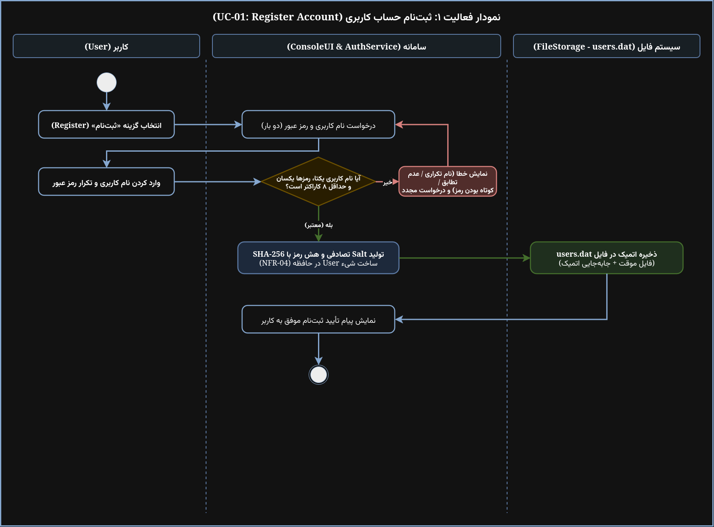 |
| ۲ | **ورود به سامانه (UC-02)** | [`UC-02_Log_In.drawio`](./UC-02_Log_In.drawio) | 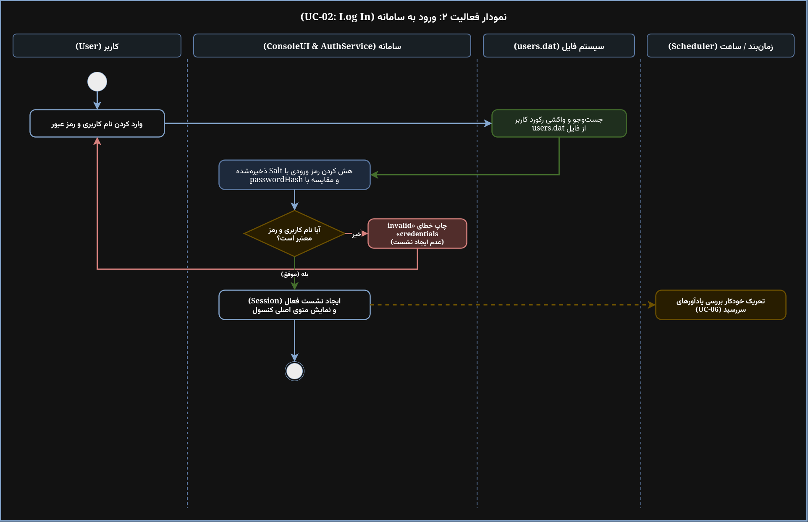 |
| ۳ | **ایجاد وظیفه (UC-03)** | [`UC-03_Create_Task.drawio`](./UC-03_Create_Task.drawio) | 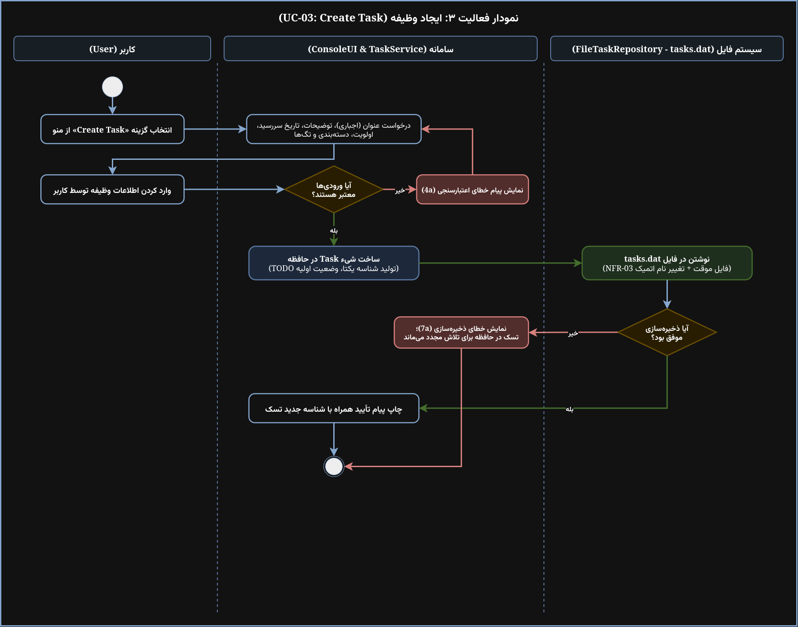 |
| ۴ | **مشاهده و جست‌وجوی وظایف (UC-04)** | [`UC-04_View_Search_Tasks.drawio`](./UC-04_View_Search_Tasks.drawio) | 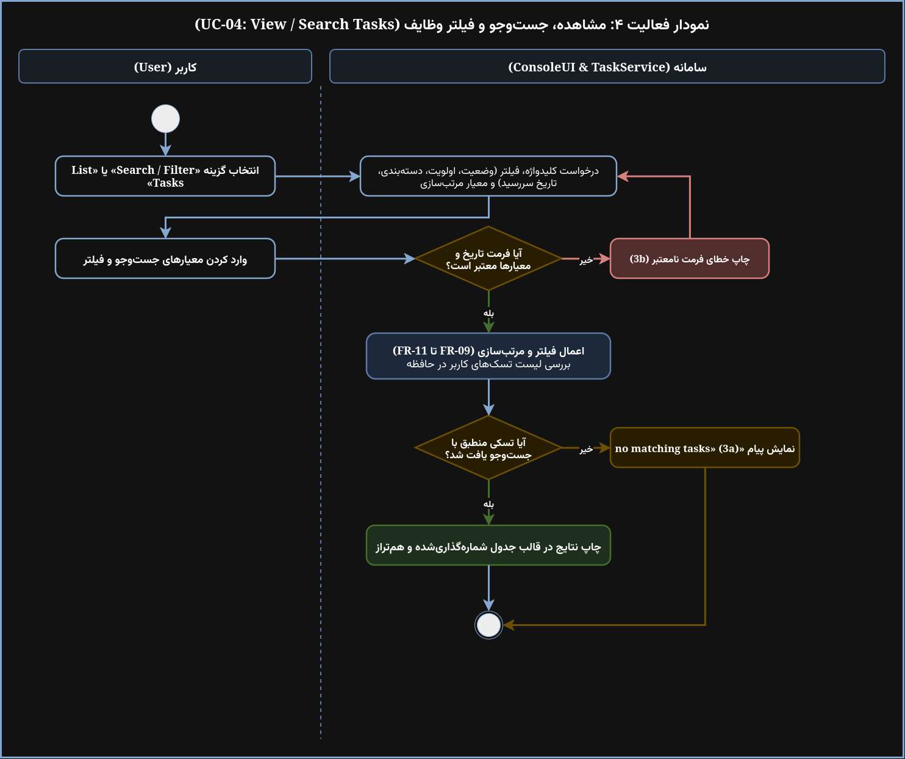 |
| ۵ | **ویرایش وظیفه (FR-06)** | [`UC-Update_Task.drawio`](./UC-Update_Task.drawio) | 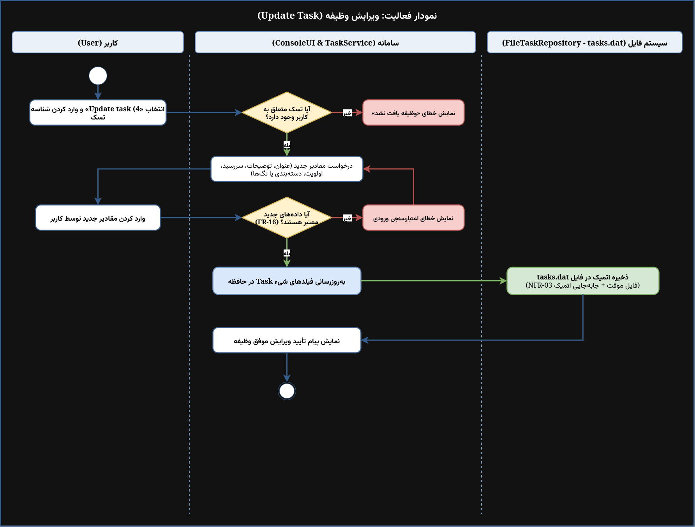 |
| ۶ | **حذف وظیفه (FR-07)** | [`UC-Delete_Task.drawio`](./UC-Delete_Task.drawio) | 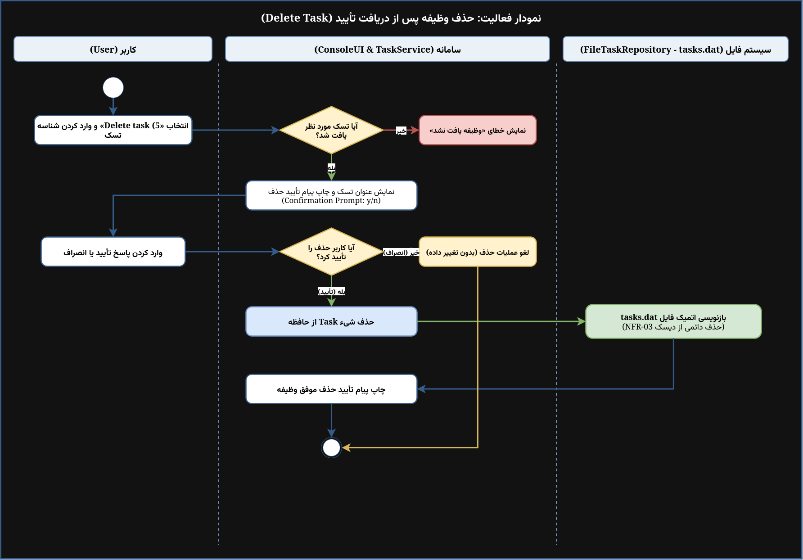 |
| ۷ | **تغییر وضعیت وظیفه (UC-05)** | [`UC-05_Change_Task_Status.drawio`](./UC-05_Change_Task_Status.drawio) | 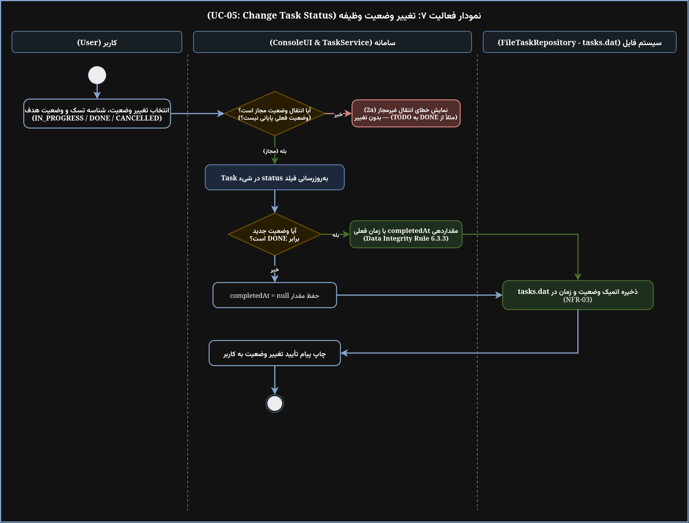 |
| ۸ | **مدیریت دسته‌بندی‌ها و تگ‌ها (FR-12, FR-13)** | [`UC-Manage_Categories_Tags.drawio`](./UC-Manage_Categories_Tags.drawio) | 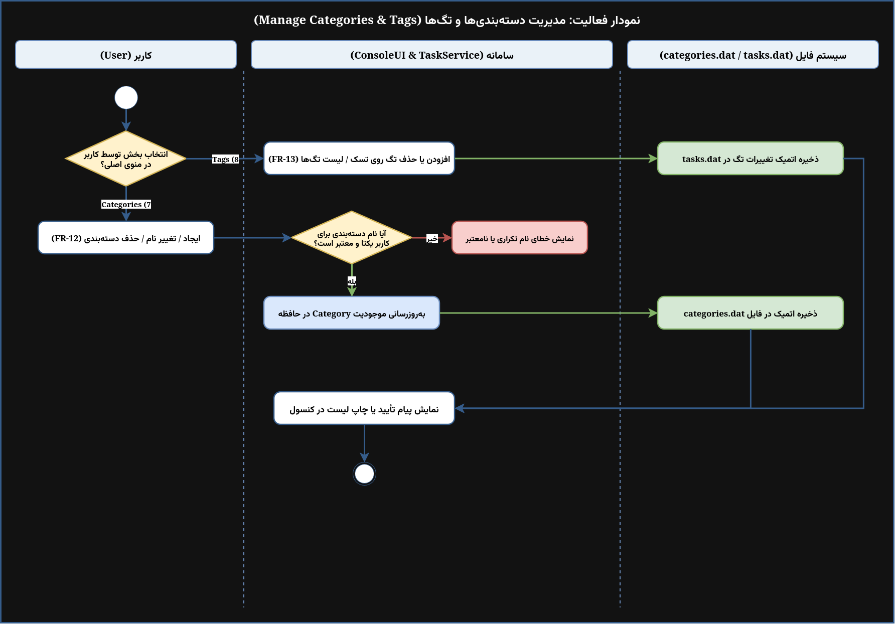 |
| ۹ | **مشاهده آمار و گزارش‌ها (FR-15)** | [`UC-View_Statistics.drawio`](./UC-View_Statistics.drawio) | 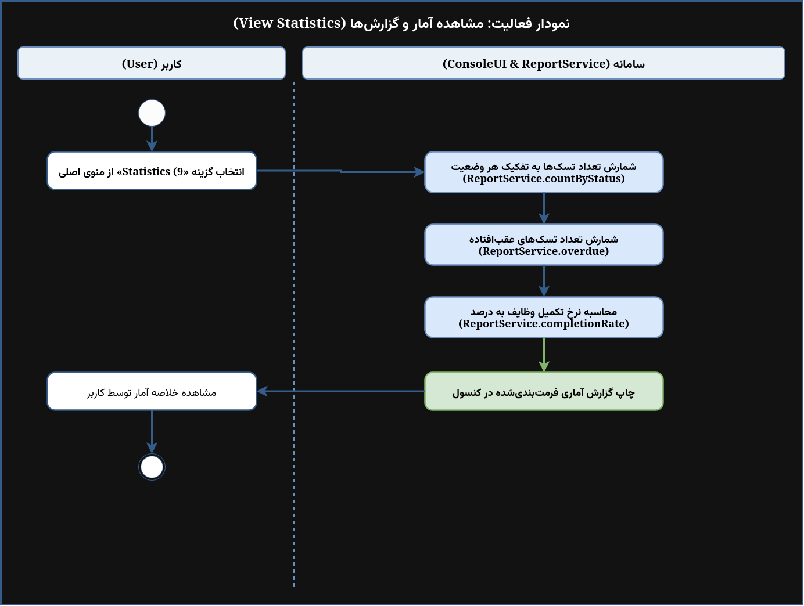 |
| ۱۰ | **دریافت اعلان یادآور (UC-06)** | [`UC-06_Receive_Due_Reminder.drawio`](./UC-06_Receive_Due_Reminder.drawio) | 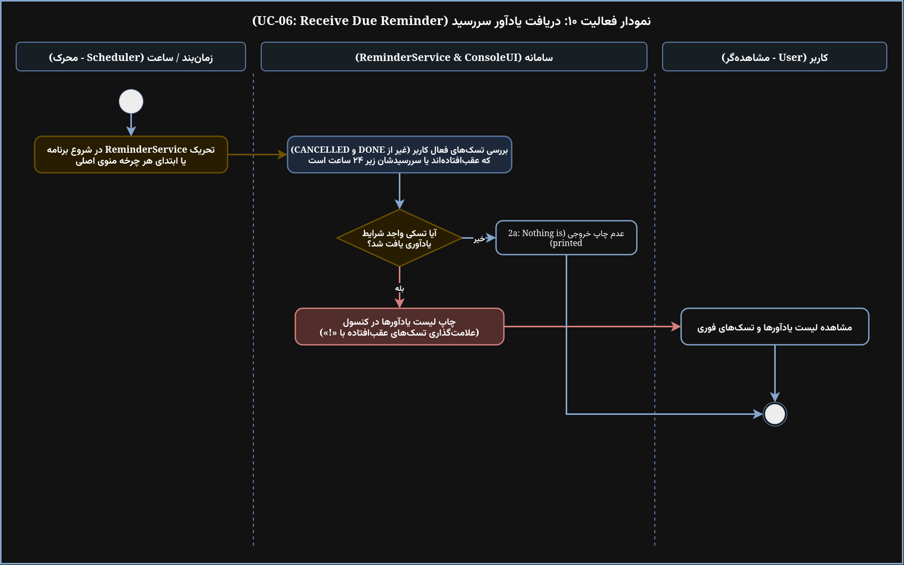 |
