# Activity Diagram — Task Lifecycle & Status Workflow

- **Document Priority:** Priority 3 (Task lifecycle from creation to completion)
- **Specification Reference:** `SRS-TM-001` (Sections `UC-01` through `UC-06`, `FR-01`–`FR-18`, `NFR-03`, `NFR-07`, and Section 6.3)

---

## 1. Overview and Purpose
The Activity Diagram models the behavioral flow, control logic, operational branching, and data persistence paths of the **Task Manager** console application. This document addresses four fundamental architectural requirements:
1. **Execution Flow:** How user input via `ConsoleUI` flows sequentially through `TaskService` and interacts with domain entities without external frameworks.
2. **Input Validation and Resilience (`NFR-07`):** How malformed or out-of-range user inputs are caught by domain validators and re-prompted without crashing the application.
3. **Task Lifecycle Management (`UC-03`, `UC-05`):** How a task progresses from instantiation (`TODO`) through active work (`IN_PROGRESS`) to terminal states (`DONE` or `CANCELLED`), enforcing business integrity constraints (`Data Integrity Rule 6.3.3`).
4. **Crash-Safe Persistence (`NFR-03`):** How operations atomically write in-memory state to disk (`tasks.dat`) using temporary files and atomic file replacement.

---

## 2. Master Activity Diagram

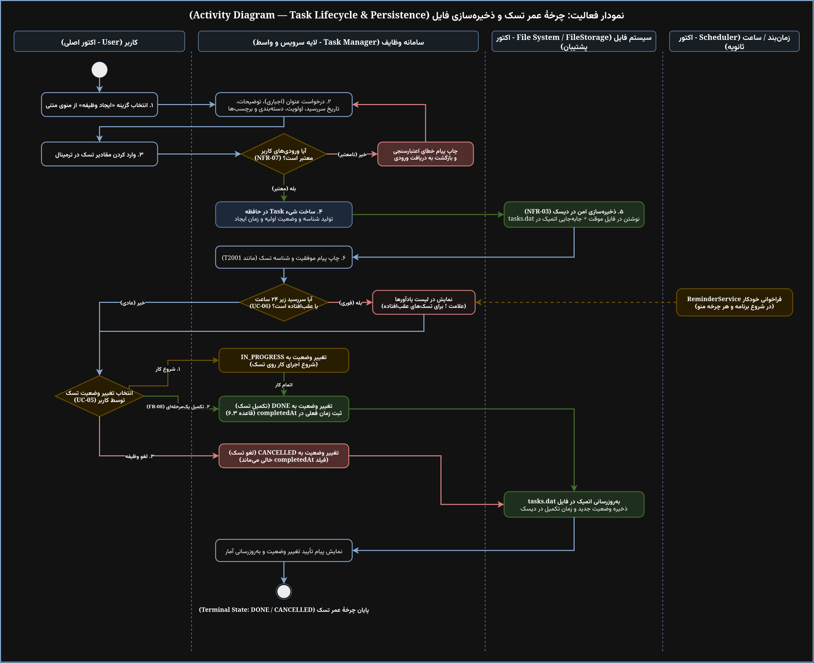

*(Editable source model available in [`task-manager-activity.drawio`](./task-manager-activity.drawio))*

---

## 3. Swimlane Architecture & Responsibilities

In accordance with Section 3.2 of `SRS-TM-001`, the system boundaries and operational concerns are partitioned across four functional swimlanes:

| Swimlane | Component / Actor Type | Architectural Responsibility |
|:---|:---|:---|
| **User** | Primary Actor | Interacts with the terminal interface, selects numbered menu actions, enters attribute values, and confirms critical mutations (e.g., deletion). |
| **Task Manager (UI & Services)** | Application Core (`ConsoleUI`, `TaskService`, `AuthService`, `ReminderService`) | Parses text streams, validates formats, enforces business logic, instantiates immutable records/domain objects, and coordinates repository calls. |
| **File System (`FileStorage`)** | Supporting Actor (`FileTaskRepository`, `FileUserRepository`) | Manages atomic file I/O operations (`tasks.dat`, `users.dat`, `categories.dat`), ensuring zero data corruption during power loss or abrupt termination (`NFR-03`). |
| **Scheduler / System Clock** | Secondary Actor | Automatically triggers `ReminderService` at application boot and before each interactive main menu evaluation cycle (`UC-06`). |

---

## 4. Status Workflow & Integrity Rules

### 4.1 State Transition Architecture
The task lifecycle is governed by a finite state machine with strict legal transition paths, single-step shortcuts, and immutable terminal states:
┌────────────────────────┐
              │       [Initial]        │
              │   Task Creation (UC-03)│
              └───────────┬────────────┘
                          │
                          ▼
                   ┌─────────────┐
                   │    TODO     │
                   └──────┬──────┘
                          │
        ┌─────────────────┼─────────────────┐
        │                 │                 │
 (1) Start Work   (2) Mark as Done   (3) Cancel
        │             (FR-08)               │
        ▼                 │                 ▼
 ┌─────────────┐          │          ┌─────────────┐
 │ IN_PROGRESS │          │          │  CANCELLED  │ ◄── [Terminal State]
 └──────┬──────┘          │          └─────────────┘     (completedAt = null)
        │                 │                 ▲
        ├─────────────────┼─────────────────┘
        │                 │            (5) Abort Work
 (4) Finish Work          │
        │                 │
        ▼                 ▼
 ┌─────────────────────────────────────────┐
 │                  DONE                   │ ◄── [Terminal State]
 │ (completedAt = LocalDateTime.now())     │
 └─────────────────────────────────────────┘

---

### 4.2 State Transition Matrix

| Current State | Target: `TODO` | Target: `IN_PROGRESS` | Target: `DONE` | Target: `CANCELLED` |
|:---|:---:|:---:|:---:|:---:|
| **`TODO`** | *N/A (Identical)* | **Valid** (Path 1) | **Valid** (Path 2, `FR-08`) | **Valid** (Path 3) |
| **`IN_PROGRESS`** | Prohibited (`2a`) | *N/A (Identical)* | **Valid** (Path 4) | **Valid** (Path 5) |
| **`DONE`** | Prohibited (`2a`) | Prohibited (`2a`) | *N/A (Identical)* | Prohibited (`2a`) |
| **`CANCELLED`** | Prohibited (`2a`) | Prohibited (`2a`) | Prohibited (`2a`) | *N/A (Identical)* |

---

### 4.3 Transition Specification & Business Semantics

1. **Path 1: `TODO → IN_PROGRESS` (Start Work)**
   - **Trigger:** User chooses option `4) Update task` or dedicated status command, selecting `IN_PROGRESS`.
   - **Invariants:** `completedAt` remains `null`.
   - **Side Effect:** Task moves from backlog to active execution. Immediately written atomically to `tasks.dat`.

2. **Path 2: `TODO → DONE` (Single-Step Completion — `FR-08`)**
   - **Trigger:** User marks a pending task as done directly from the menu in one step.
   - **Invariants:** Satisfies `FR-08` without requiring an intermediate `IN_PROGRESS` state.
   - **Side Effect:** System sets `completedAt = LocalDateTime.now()` (`Rule 6.3.3`) and commits to storage.

3. **Path 3: `TODO → CANCELLED` (Cancel Pending Task)**
   - **Trigger:** User marks task as cancelled before work begins.
   - **Invariants:** `completedAt` remains `null`. The task reaches a terminal state and will no longer appear in due reminder evaluations (`UC-06`).

4. **Path 4: `IN_PROGRESS → DONE` (Complete Active Task)**
   - **Trigger:** User completes work and marks task as done.
   - **Invariants:** System stamps `completedAt = LocalDateTime.now()`.
   - **Side Effect:** Increments the user's completion rate in `ReportService` (`FR-15`).

5. **Path 5: `IN_PROGRESS → CANCELLED` (Abort In-Progress Task)**
   - **Trigger:** Task execution is discontinued or invalidated.
   - **Invariants:** `completedAt` remains `null`. Transition is permanent.

---

### 4.4 Illegal Transitions & Exception Handling (`UC-05` Branch `2a`)

Any transition not explicitly defined as **Valid** in Section 4.2 violates domain invariants.
* **Prohibited Scenarios:**
  - Attempting to reopen a finished task: `DONE → TODO` or `DONE → IN_PROGRESS`.
  - Attempting to revive a cancelled task: `CANCELLED → TODO` or `CANCELLED → IN_PROGRESS`.
  - Attempting to switch between terminal states: `DONE → CANCELLED` or `CANCELLED → DONE`.
  - Regressing an active task back to backlog: `IN_PROGRESS → TODO`.
* **System Behavior:**
  1. The validator catches the illegal transition before repository delegation.
  2. The system emits a clear, column-aligned diagnostic message (`NFR-08`):
     `"Error: Illegal status transition from [CURRENT_STATUS] to [TARGET_STATUS]."`
  3. No state mutation occurs in memory; the existing file on disk (`tasks.dat`) remains untouched.
  4. Control returns safely to the main menu without throwing uncaught exceptions (`NFR-07`).

---

### 4.5 Data Integrity Constraints (`SRS Section 6.3`)

Every status mutation strictly enforces the contractual domain rules:
* **Rule 6.3.1 (User Ownership):** A task always belongs to exactly one existing user (`userId`). A user can only inspect and transition their own tasks.
* **Rule 6.3.2 (Category Integrity):** A task's category must be either empty or correspond to an existing category belonging to the same user.
* **Rule 6.3.3 (Completion Timestamp):** `completedAt` is populated **if and only if** the status is `DONE`. If status $\ne$ `DONE`, `completedAt` must evaluate to `null` and serialize as an empty field.
* **Rule 6.3.4 (Identifier Uniqueness):** Task IDs are immutable, unique, and never recycled after deletion or state changes.
* **Rule 6.3.5 (Malformed Line Handling):** Corrupt records encountered during deserialization are skipped and logged to stderr without halting system boot.

---

### 4.6 Disk Persistence Format Alignment (`tasks.dat`)

Data mutations are reflected immediately in the pipe-delimited persistence store (`FR-17`):
* **Format:**
  `ID|USER_ID|TITLE|DESCRIPTION|DUE_DATE|PRIORITY|STATUS|CATEGORY_ID|TAGS|CREATED_AT|COMPLETED_AT`
* **Before Completion (`TODO`):**
  `T2001|U1001|Write SRS|Chapter 1-8|2026-11-15|HIGH|TODO|C3001|design,srs|2026-11-02|`
* **After Completion (`DONE`):**
  `T2001|U1001|Write SRS|Chapter 1-8|2026-11-15|HIGH|DONE|C3001|design,srs|2026-11-02|2026-11-02T14:30:00`

---

## 5. Resilience & Storage Safety

1. **Validation Loops (`NFR-07`):** User inputs (dates, priority strings, non-empty titles) are evaluated immediately after capture. If invalid, a descriptive error is printed to stdout, and the flow loops back to the entry prompt without process exit.
2. **Atomic Persistence (`NFR-03`):** Every mutation triggers an atomic disk write:
   $$\text{Write Payload} \longrightarrow \text{temp file (e.g., tasks.dat.tmp)} \xrightarrow{\text{Atomic Move}} \text{tasks.dat}$$
   This guarantees that an abrupt process kill or disk interruption leaves previous valid data completely intact.

---

## 6. Due-Date & Reminder Automation (`UC-06`)

1. **Trigger:** Activated upon successful user login (`UC-02`) and at the start of each console menu cycle.
2. **Filter Logic:** Collects tasks meeting the following predicate:
   $$\text{Task} \in \{\text{Active Tasks}\} \iff \text{status} \notin \{\text{DONE}, \text{CANCELLED}\} \land (\text{dueDate} < \text{today} \lor \text{dueDate} \le \text{today} + 24\text{h})$$
3. **Alert Display:** Overdue tasks are prepended with an exclamation indicator (`!`) to draw immediate user focus.

---

## 7. Individual Use Case Diagrams Catalog

Each functional area defined in the SRS Use Case Model is mapped to its dedicated activity diagram:

| Item | Use Case / Requirement | Source Diagram (`.drawio`) | High-Resolution Image (`.png`) |
|:---:|:---|:---:|:---:|
| 1 | **UC-01: Register Account** | [`UC-01_Register_Account.drawio`](./UC-01_Register_Account.drawio) | 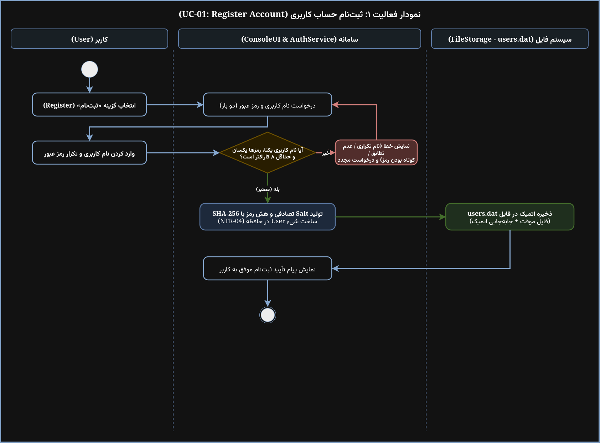 |
| 2 | **UC-02: Log In** | [`UC-02_Log_In.drawio`](./UC-02_Log_In.drawio) | 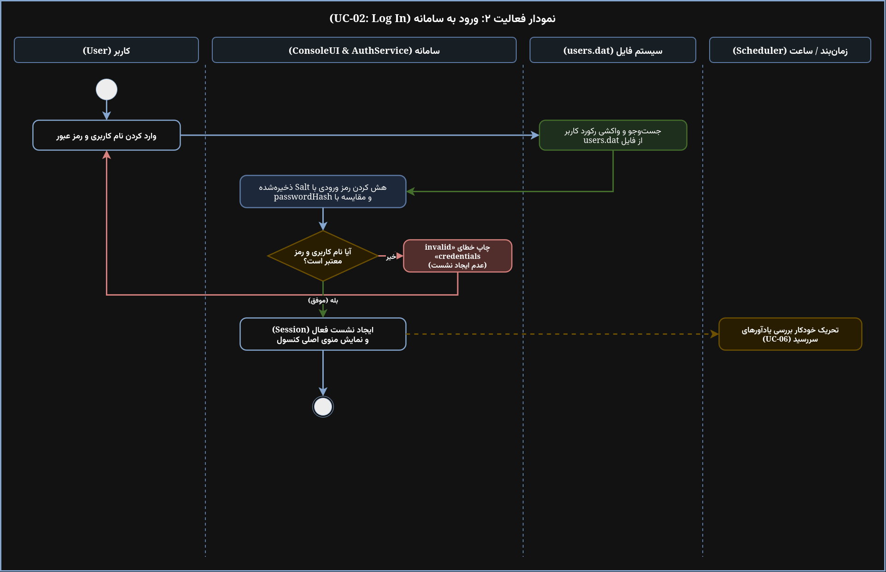 |
| 3 | **UC-03: Create Task** | [`UC-03_Create_Task.drawio`](./UC-03_Create_Task.drawio) | 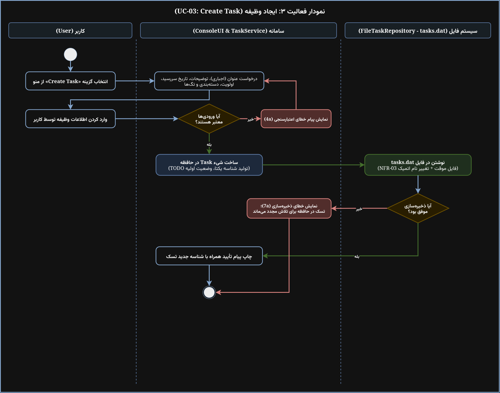 |
| 4 | **UC-04: View / Search Tasks** | [`UC-04_View_Search_Tasks.drawio`](./UC-04_View_Search_Tasks.drawio) | 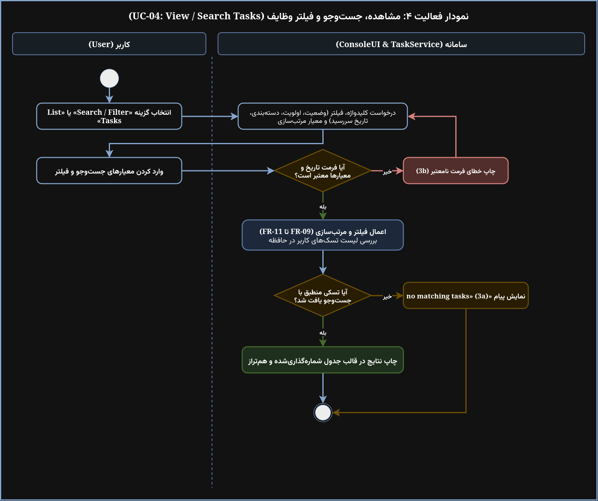 |
| 5 | **Update Task (FR-06)** | [`UC-Update_Task.drawio`](./UC-Update_Task.drawio) | 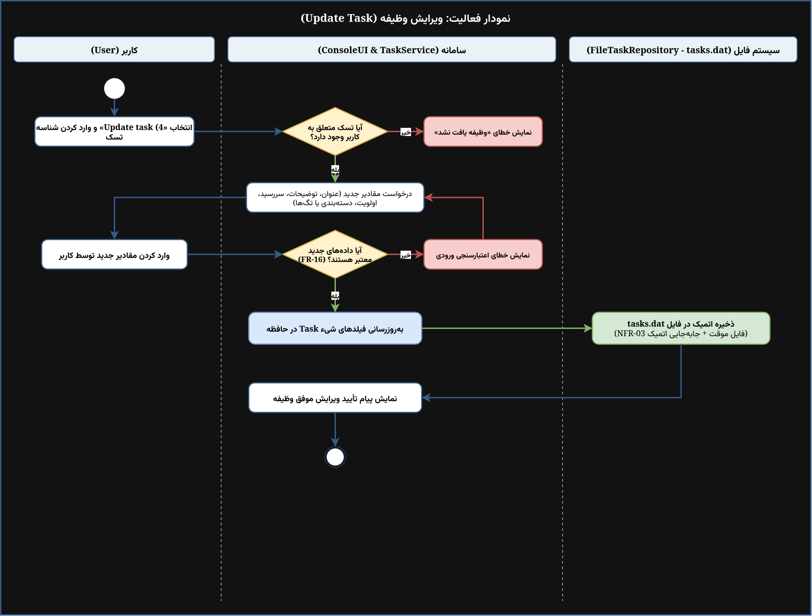 |
| 6 | **Delete Task (FR-07)** | [`UC-Delete_Task.drawio`](./UC-Delete_Task.drawio) | 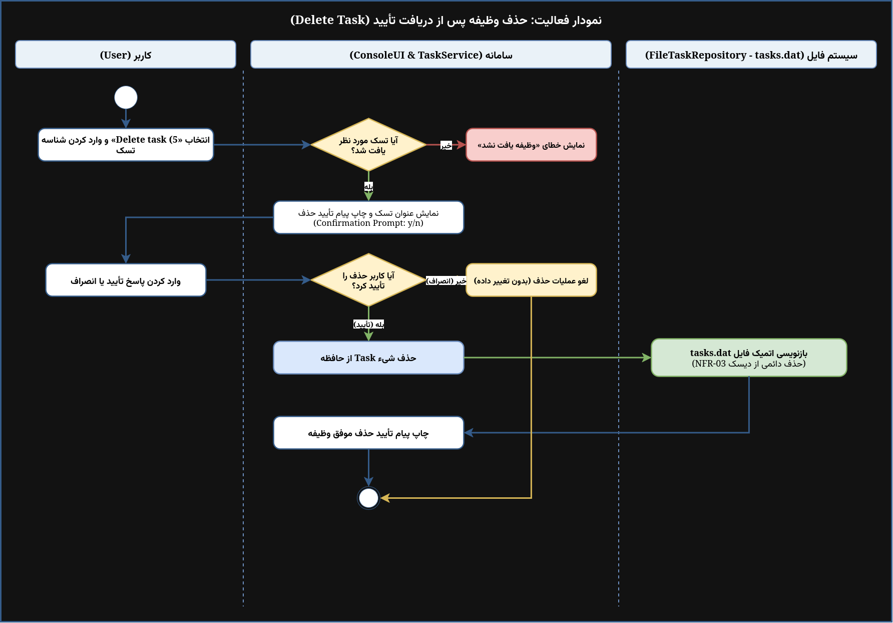 |
| 7 | **UC-05: Change Task Status** | [`UC-05_Change_Task_Status.drawio`](./UC-05_Change_Task_Status.drawio) | 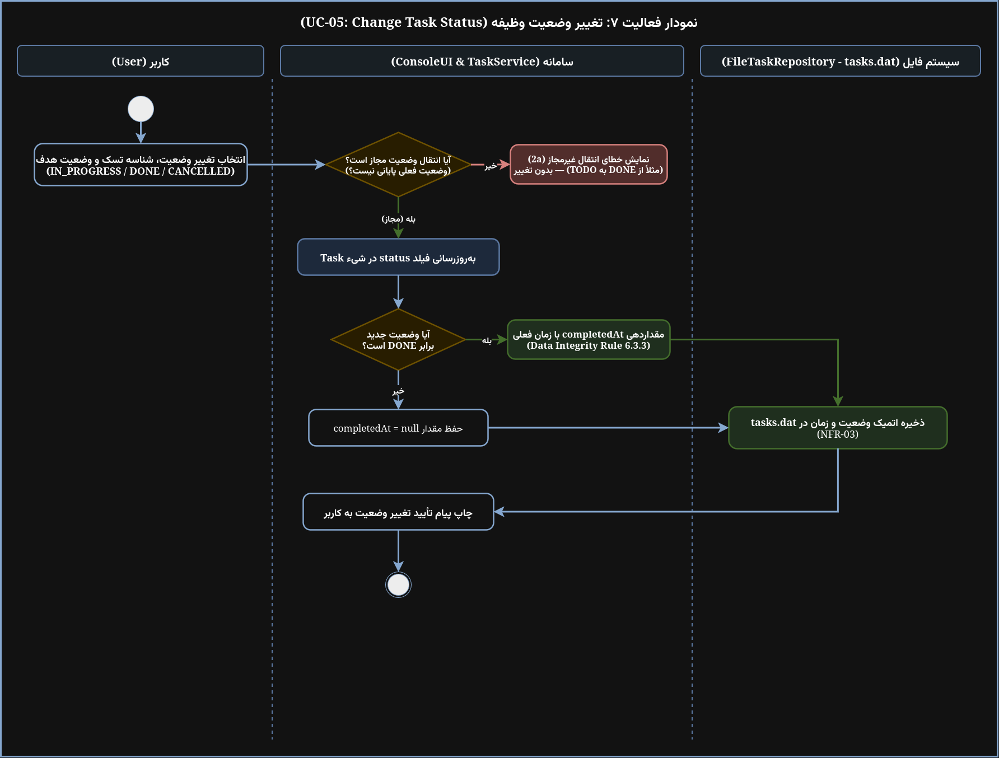 |
| 8 | **Manage Categories & Tags (FR-12, FR-13)** | [`UC-Manage_Categories_Tags.drawio`](./UC-Manage_Categories_Tags.drawio) | 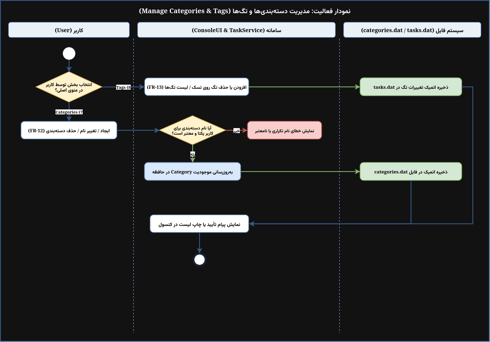 |
| 9 | **View Statistics (FR-15)** | [`UC-View_Statistics.drawio`](./UC-View_Statistics.drawio) | 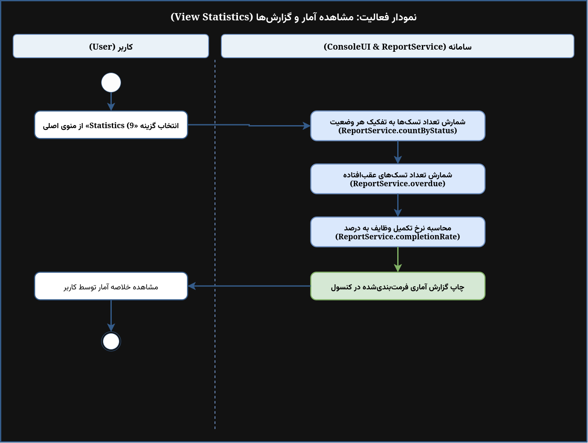 |
| 10 | **UC-06: Receive Due Reminder** | [`UC-06_Receive_Due_Reminder.drawio`](./UC-06_Receive_Due_Reminder.drawio) | 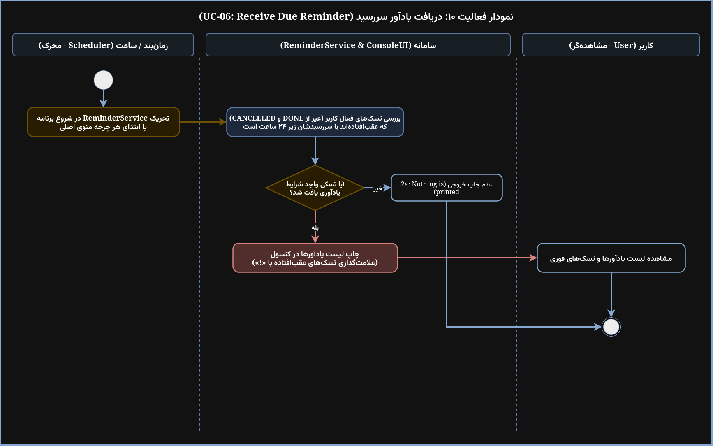 |
