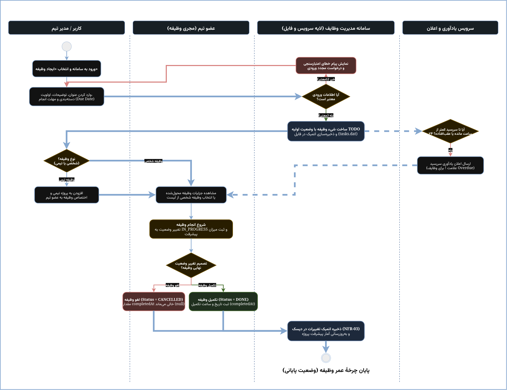

# Activity Diagram — Task Lifecycle & Status Workflow

- **Document Priority:** Priority 3 (Task lifecycle from creation to completion)
- **Specification Reference:** `SRS-TM-001` (Sections `UC-03`, `UC-05`, `FR-04`, `FR-08`, and `NFR-03`)

---

## 1. Overview and Purpose
The Activity Diagram models the behavioral flow, control paths, and operational sequence within the **Task Manager** system. This document addresses four fundamental architectural questions:
1. **Execution Flow:** How user input via `ConsoleUI` flows through `TaskService` and interacts with the domain entities.
2. **Input Validation and Resilience:** How invalid inputs are captured and handled gracefully without terminating the application (`NFR-07`).
3. **Task Lifecycle Management:** How a task transitions from its initial state (`TODO`) to its terminal states (`DONE` or `CANCELLED`), enforcing business integrity constraints (`Data Integrity Rule 6.3.3`).
4. **Automated Reminders:** How the system periodically evaluates upcoming and overdue tasks to trigger alerts via the reminder mechanism (`UC-06`).

---

## 2. Activity Diagram

*(The editable source model is available in [`task-manager-activity.drawio`](./task-manager-activity.drawio))*

---

## 3. Swimlane Architecture & Responsibilities

The workflow is organized into four distinct swimlanes to align operational concerns:

| Swimlane | Responsibility & Scope |
|:---|:---|
| **User / Team Manager** | Authenticates, triggers task creation, defines attributes (title, priority, deadline, category), and assigns tasks to team members. |
| **Team Member (Assignee)** | Reviews assigned tasks, transitions status to `IN_PROGRESS`, records work progress, and initiates final state resolution. |
| **Task Manager System (Service & Storage)** | Validates inputs, creates memory objects, records `completedAt` timestamps, and executes atomic file persistence (`tasks.dat`). |
| **Reminder & Notification Service** | Actively checks due dates, identifying items that are overdue or due within 24 hours to issue prioritized reminders. |

---

## 4. Status Workflow & Integrity Rules

The application enforces a deterministic task state transition model:
