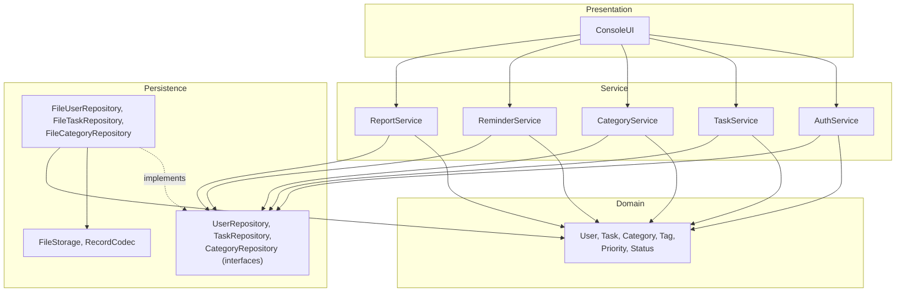
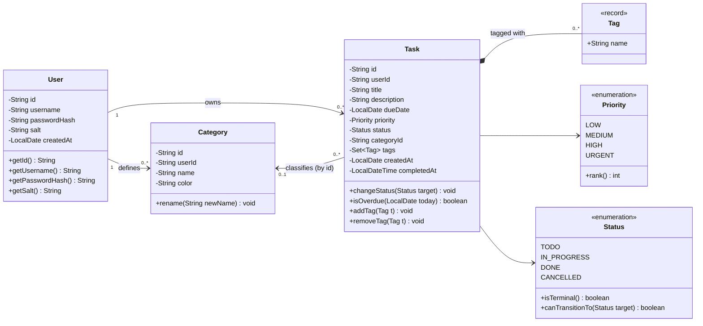
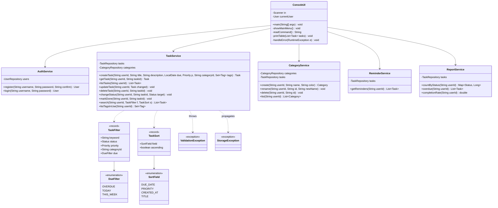
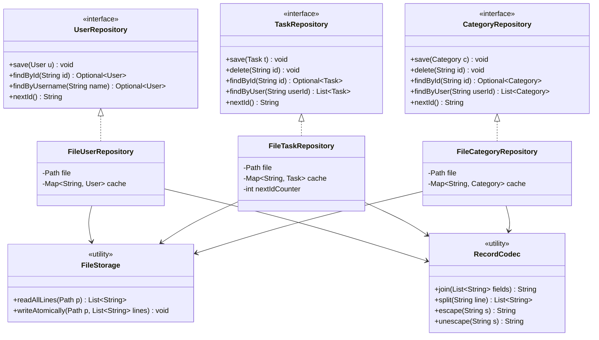
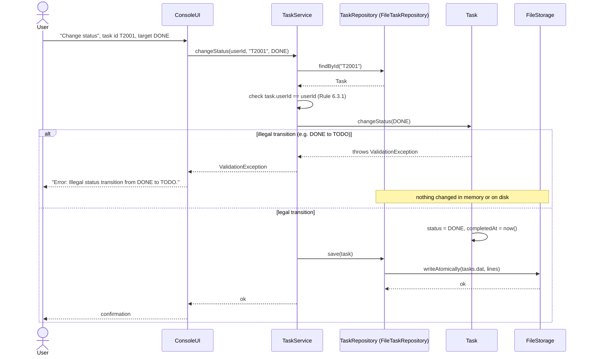

# Class Diagram — Task Manager

- **Specification reference:** `SRS-TM-001` (Sections 2.1, 3, 4, 6, 7), Activity Diagram (status workflow)
- **Companion document:** [`data-model.md`](./data-model.md) (what is *stored*; this document describes how the *code* is structured)
- **Notation:** UML 2.5, rendered with Mermaid (GitHub renders it natively)

---

## 1. Purpose and scope

This document shows the main classes of the Task Manager, what each class is responsible for, and how the classes depend on each other. It follows the four-layer architecture of the SRS (Presentation → Service → Domain ← Persistence).

Only classes that have a real responsibility are shown. Small helper types are included only where an SRS requirement needs them (for example filtering and sorting, FR-10 and FR-11).

> **Class diagram vs. data model.** The class diagram describes the *structure of the code*: behaviour, responsibilities and dependencies. The data model describes the *information that is stored*: fields, identifiers and constraints. For example, `Task` in code has a `changeStatus()` method and holds `Tag` objects; in the data model a task is a record with a `tags` column. See `data-model.md`.

---

## 2. Layer overview

**Dependency rules**

| Layer | May depend on | Must not depend on |
|---|---|---|
| Presentation | Service, Domain (for display only) | Persistence |
| Service | Domain, repository **interfaces** | Presentation, `File*` classes |
| Domain | JDK only | everything else |
| Persistence | Domain, JDK | Service, Presentation |

---

## 3. Domain layer

### Responsibilities

| Class | Responsibility |
|---|---|
| `User` | Holds account data. Stores only the salted hash, never the password (NFR-04). |
| `Task` | Core entity. **Owns the invariants** of a single task: legal status transitions and the rule that `completedAt` is set if and only if the status is `DONE` (Rule 6.3.3). |
| `Category` | A named, coloured grouping owned by one user. |
| `Tag` | Value object (a record) wrapping a normalised tag name. Has no id of its own. |
| `Priority` | Ordered enum; `rank()` is used for sorting. |
| `Status` | Enum that knows the legal workflow (`canTransitionTo`) and which states are terminal. |

### Status workflow encoded in `Status.canTransitionTo`

| From \ To | TODO | IN_PROGRESS | DONE | CANCELLED |
|---|:-:|:-:|:-:|:-:|
| **TODO** | – | yes | yes | yes |
| **IN_PROGRESS** | no | – | yes | yes |
| **DONE** | no | no | – | no |
| **CANCELLED** | no | no | no | no |

---

## 4. Presentation and service layers

*(Services also depend on the domain classes and repository interfaces from Sections 3 and 5; those arrows are omitted here for readability.)*

### Responsibilities

| Class | Responsibility |
|---|---|
| `ConsoleUI` | Only layer that talks to the terminal: prints menus and tables, reads and parses input, holds the current session user, and turns exceptions into readable messages (NFR-07, NFR-08). Contains **no business rules**. |
| `AuthService` | Registration rules (unique username, password ≥ 8 characters, confirmation match), salt generation, SHA-256 hashing, credential check with the generic "invalid credentials" error. |
| `TaskService` | Task CRUD, validation (mandatory title, valid category, tag rules), status change, search/filter/sort. Always checks that the task belongs to `userId` (Rule 6.3.1). |
| `CategoryService` | Category CRUD with per-user unique names. On delete it clears `categoryId` of affected tasks so Rule 6.3.2 stays true. |
| `ReminderService` | Selects tasks that are not `DONE`/`CANCELLED` and are overdue or due within the next 24 hours (UC-06). |
| `ReportService` | Statistics: count per status, overdue tasks, completion rate (FR-15). |
| `TaskFilter`, `TaskSort` | Small immutable parameter objects so `search()` does not need many arguments. |
| `ValidationException` | Signals invalid input or an illegal status transition. The UI prints the message and returns to the menu. |
| `StorageException` | Wraps `IOException` from the persistence layer (UC-03 flow 7a). |

---

## 5. Persistence layer

### Responsibilities

| Class | Responsibility |
|---|---|
| `*Repository` (interfaces) | The only persistence API the services know (NFR-09). No file or `IOException` types appear in the signatures. |
| `File*Repository` | Load the file once at start-up into an in-memory map (needed for NFR-01/02), skip and report malformed lines (Rule 6.3.5), and rewrite the file after every mutation (FR-17). Map between domain objects and text records. |
| `FileStorage` | Reads lines and writes a list of lines safely: write `*.tmp`, then `Files.move(..., ATOMIC_MOVE)` (NFR-03). Knows nothing about tasks. |
| `RecordCodec` | Pipe-delimited record format: join, split, and escaping. Keeps the format rules in one place. |

---

## 6. User story trace — "Change a task's status" (UC-05, with error case)

**Story:** *As a user I want to mark a task as done so that I can see my progress.*

| Step | Layer | Data read | Data changed |
|---|---|---|---|
| Menu input | Presentation | – | – |
| Ownership check | Service | `Task.userId` | – |
| Transition check | Domain | `Task.status` | – |
| Set `completedAt` | Domain | – | `Task.status`, `Task.completedAt` |
| Save | Persistence | all lines of `tasks.dat` (cached) | the `T2001` line in `tasks.dat` |

**Error case:** if the transition is illegal, the `Task` is not modified and the repository is never called, so `tasks.dat` stays untouched (UC-05 alternative flow 2a, NFR-07).

---

## 7. Requirement traceability

| Requirement | Main classes |
|---|---|
| FR-01, FR-02, FR-03 | `AuthService`, `User`, `UserRepository`, `ConsoleUI` (session) |
| FR-04 – FR-08 | `TaskService`, `Task`, `Status`, `TaskRepository` |
| FR-09 – FR-11 | `TaskService`, `TaskFilter`, `TaskSort` |
| FR-12 | `CategoryService`, `Category`, `CategoryRepository` |
| FR-13 | `Task` (`addTag`/`removeTag`), `Tag`, `TaskService.listTagsInUse` |
| FR-14 | `ReminderService` |
| FR-15 | `ReportService` |
| FR-16 | `ValidationException`, `ConsoleUI.handleError` |
| FR-17 | `File*Repository`, `FileStorage` |
| FR-18 | `ConsoleUI` (help command) |
| NFR-03 | `FileStorage.writeAtomically` |
| NFR-04 | `AuthService`, `User` |
| NFR-06, NFR-09 | layering rules (Section 2), repository interfaces |

---

## 8. Contradictions found and fixed

| # | Where | Contradiction | Resolution |
|---|---|---|---|
| 1 | SRS PDF class diagram vs. `tasks.dat` | Class diagram uses `id : int`, but files use ids like `T2001`, `U1001`, `C3001`. | All ids are `String` with a type prefix (`U`, `T`, `C`). |
| 2 | SRS PDF class diagram vs. data model | `Task` had no `userId` or `createdAt`, and held a `Category` object, while the data model stores `userId`, `createdAt` and `categoryId`. | `Task` now has `userId`, `createdAt` and `categoryId`; the service resolves the category when needed. |
| 3 | SRS PDF class diagram vs. ER diagram | `User.salt : byte[]`, but the ER diagram and file use `CHAR(32)`. | `salt` is a 32-character hex `String`. Hash is a 64-character hex `String`. |
| 4 | SRS PDF vs. activity diagram | `completedAt` is `LocalDateTime` in the class diagram and the activity diagram, but `DATE` in the ER diagram. | `completedAt` is a date-time everywhere (see data model). |
| 5 | SRS Section 1.3 vs. Rule 6.3.2 | A category is "exactly one per task", but a task's category may be empty. | Multiplicity is `0..1`. |
| 6 | SRS Section 3.2 | `TaskService.search(f : Filter)` uses a type that is not defined anywhere. | Defined `TaskFilter`, `TaskSort`, `DueFilter`, `SortField`. |
| 7 | SRS Sections 2.1, 6.2 | `categories.dat` exists, but there is no `CategoryRepository` or class that manages categories (FR-12). | Added `CategoryRepository`, `FileCategoryRepository` and `CategoryService`. **The SRS service/persistence lists must be updated.** |
| 8 | SRS Section 6.3 Rule 4 | "Ids are never reused", but `max(id)+1` reuses the id of a deleted last record. | The next id is stored in the file header (see `data-model.md`). |
| 9 | SRS PDF class diagram | `User.verifyPassword()` in the domain implies hashing logic in a plain domain object. | Hashing and verification live in `AuthService`; `User` only stores data. |
| 10 | SRS PDF vs. SRS `.md` | The PDF contains FR-16 – FR-18 and NFR-10; the `.md` version stops at FR-15 / NFR-09, while the activity diagram cites FR-17/FR-18. | The `.md` SRS should be updated to match the PDF. |

### Open point

`completionRate` is not defined precisely in the SRS. Proposed definition for the team to confirm: `DONE / (all tasks − CANCELLED)`, and `0` when the denominator is `0`.
