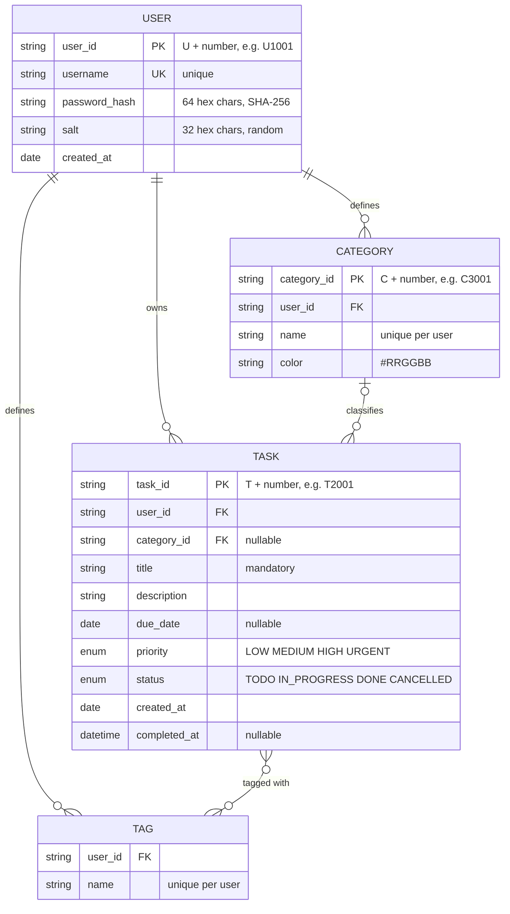

# Data Model — Task Manager

- **Specification reference:** `SRS-TM-001` (Sections 6.1–6.3, FR-12, FR-13, FR-17, NFR-03)
- **Companion document:** [`class-diagram.md`](./class-diagram.md) (code structure)

---

## 1. Purpose

This document defines **what information is stored**: entities, fields, identifiers, relationships and constraints, and how they are written to the three data files.

> **Data model vs. class diagram.** The data model describes stored information and its rules. The class diagram describes code: methods, responsibilities and dependencies. Example: `Task` in code holds a `Set<Tag>` and has `changeStatus()`. In the data model a task is a record whose `tags` field is a comma-separated list, and there are no methods.

---

## 2. Entity-relationship diagram (logical model)



**Tag note.** Logically a task and a tag are many-to-many. In the files this relationship is **not** a separate table: tags are stored inside the task record (`tags` field) and there is no `tags.dat`. A tag therefore exists only while at least one task uses it, which is exactly what FR-13 ("list all tags in use") needs. Tag identity is `(user_id, name)`; a tag has no id of its own.

---

## 3. Entities and fields

### 3.1 User (`users.dat`)

| Field | Type | Required | Constraint |
|---|---|:-:|---|
| `id` | String | yes | Primary key. Format `U<number>`. Immutable, never reused. |
| `username` | String | yes | Unique (case-insensitive compare). 3–30 characters, no `\|`. |
| `passwordHash` | String | yes | 64 hex characters (SHA-256 of salt + password). |
| `salt` | String | yes | 32 hex characters, random per user. |
| `createdAt` | Date | yes | ISO format `YYYY-MM-DD`. |

The plain password is never stored (NFR-04).

### 3.2 Category (`categories.dat`)

| Field | Type | Required | Constraint |
|---|---|:-:|---|
| `id` | String | yes | Primary key. Format `C<number>`. |
| `userId` | String | yes | Foreign key → `User.id`. |
| `name` | String | yes | Unique **per user**. Not blank. |
| `color` | String | yes | `#RRGGBB`. Default `#999999`. |

### 3.3 Task (`tasks.dat`)

| Field | Type | Required | Constraint |
|---|---|:-:|---|
| `id` | String | yes | Primary key. Format `T<number>`. Immutable, never reused. |
| `userId` | String | yes | Foreign key → `User.id`. |
| `title` | String | yes | Not blank, max 100 characters. |
| `description` | String | no | May be empty. |
| `dueDate` | Date | no | `YYYY-MM-DD`, empty = none. |
| `priority` | Enum | yes | `LOW`, `MEDIUM`, `HIGH`, `URGENT`. |
| `status` | Enum | yes | `TODO`, `IN_PROGRESS`, `DONE`, `CANCELLED`. Initial value `TODO`. |
| `categoryId` | String | no | Empty or foreign key → `Category.id` of the **same user**. |
| `tags` | List of String | no | Comma-separated, each tag trimmed, lower-case, no `,` and no `\|`, no duplicates. |
| `createdAt` | Date | yes | `YYYY-MM-DD`. Never changes. |
| `completedAt` | DateTime | no | `YYYY-MM-DDTHH:mm:ss`. Set if and only if `status = DONE`. |

### 3.4 Tag (embedded in `Task.tags`)

| Field | Type | Constraint |
|---|---|---|
| `name` | String | Unique per user (by lower-case comparison), 1–30 characters. |

---

## 4. Identifiers

- Every id is a prefix letter plus a number: `U1001`, `C3001`, `T2001`. The prefix makes ids readable and prevents mixing entity types.
- Each file stores its own counter in the header (see Section 5), and a new id is built from that counter. The counter only increases, so a deleted id is **never reused** (Rule 6.3.4). Taking `max(id) + 1` from the records would reuse the id of a deleted last record, so it is not used.

---

## 5. File format

Three UTF-8 text files, one record per line, fields separated by `|`.

- Line 1: format version `# v1`
- Line 2: id counter `# next-id: <number>`
- From line 3: records

The delimiter `|` inside a field is written as `\p` and a backslash as `\\`; both are reversed on read.

**`users.dat`** — `id|username|passwordHash|salt|createdAt`

```text
# v1
# next-id: 1002
U1001|alice|9f2c...|3b71...|2026-10-20
```

**`categories.dat`** — `id|userId|name|color`

```text
# v1
# next-id: 3002
C3001|U1001|University|#3366cc
```

**`tasks.dat`** — `id|userId|title|description|dueDate|priority|status|categoryId|tags|createdAt|completedAt`

```text
# v1
# next-id: 2003
T2001|U1001|Write SRS|Chapter 1-8|2026-11-15|HIGH|DONE|C3001|design,srs|2026-11-02|2026-11-08T14:30:00
T2002|U1001|Draw class diagram||2026-11-12|MEDIUM|TODO|C3001|design|2026-11-09|
```

Every task line has exactly **11 fields**. An empty field (for example an unfinished task's `completedAt`) is written as nothing between two `|`, so the line of a `TODO` task ends with `|`.

**Write rule (NFR-03).** The whole file is written to `<file>.tmp` and then moved over the original with an atomic move. A crash therefore leaves either the old or the new file, never a half-written one.

---

## 6. Data integrity rules

| # | Rule | Enforced by |
|---|---|---|
| 1 | A task belongs to exactly one existing user. | `TaskService` (sets `userId` from session; checks on every access) |
| 2 | `categoryId` is empty or an existing category of the same user. | `TaskService` on create/update; `CategoryService.delete` clears it |
| 3 | `completedAt` is set if and only if `status = DONE`. | `Task.changeStatus`; load check |
| 4 | Ids are unique and never reused. | `next-id` counter in the file header |
| 5 | Malformed lines are skipped and reported, never silently accepted. | `File*Repository` on load |
| 6 | `username` is unique; `Category.name` is unique per user. | `AuthService`, `CategoryService` |
| 7 | Status changes follow the legal workflow (see `class-diagram.md`, Section 3). | `Status.canTransitionTo` |
| 8 | Deleting a category does not delete its tasks; their `categoryId` becomes empty. | `CategoryService.delete` |

**What counts as malformed on load:** wrong number of fields, unknown enum value, unparsable date, an unknown `userId`, a `categoryId` that does not exist for that user, or `completedAt` inconsistent with `status`. Such a line is skipped, a message with the line number is printed to stderr, and start-up continues.

---

## 7. Mapping: stored data ↔ code

| Stored | Code (`class-diagram.md`) |
|---|---|
| `users.dat` record | `User` |
| `categories.dat` record | `Category` |
| `tasks.dat` record | `Task` |
| `tags` field | `Set<Tag>` inside `Task` |
| `priority`, `status` text | `Priority`, `Status` enums |
| `next-id` header | `Repository.nextId()` |
| date / date-time text | `LocalDate` / `LocalDateTime` |

---

## 8. User story trace — "Mark a task as done"

**Story:** *As a user I want to mark a task as done so that I can see my progress.*

Before (`tasks.dat`):

```text
T2002|U1001|Draw class diagram||2026-11-12|MEDIUM|TODO|C3001|design|2026-11-09|
```

After a successful change to `DONE`:

```text
T2002|U1001|Draw class diagram||2026-11-12|MEDIUM|DONE|C3001|design|2026-11-09|2026-11-09T16:05:12
```

| Data | Read | Changed |
|---|---|---|
| `tasks.dat` line of `T2002` | yes (`userId`, `status`) | `status`, `completedAt` |
| `users.dat`, `categories.dat` | no | no |

**Error case:** the user tries to change the same task from `DONE` back to `TODO`. The transition is illegal, so the task is not modified and `tasks.dat` is not rewritten. The user sees `Error: Illegal status transition from DONE to TODO.`

---

## 9. Contradictions found and fixed

| # | Where | Contradiction | Resolution |
|---|---|---|---|
| 1 | SRS Section 6.2 vs. activity diagram Section 4.6 | The SRS example `tasks.dat` line has 11 fields in the activity diagram but shows only 10 fields for a `TODO` row in the SRS (`completedAt` is missing; the line ends after `createdAt\|`). | Exactly 11 fields per line, as in Section 5. |
| 2 | SRS ER diagram | `completed_at : DATE`, but the activity diagram uses `LocalDateTime` (`2026-11-02T14:30:00`). | `completedAt` is a DateTime. |
| 3 | SRS ER diagram vs. files | The ER diagram has a `TAG` table with `tag_id` and a `TASK_TAG` junction table; the files have neither. | Tag has no id; tags are embedded in the task record. The ER diagram above shows this honestly. |
| 4 | SRS ER diagram vs. files | Ids are `INT` in the ER diagram, but `U1001`, `T2001`, `C3001` in the files. | Ids are prefixed strings. |
| 5 | SRS ER diagram | `salt : CHAR(32)` and `password_hash : CHAR(64)` are correct for the file, but the class diagram used `byte[]`. | Both are hex strings in code and data. |
| 6 | SRS Rule 6.3.4 | "Never reused" is not guaranteed by `max(id)+1`. | `next-id` header line. |
| 7 | SRS example data | Sample dates are in 2025 (`2025-02-01`), the SRS is dated October 2026, and the activity diagram uses 2026 dates. | Examples here use 2026 dates. The SRS examples should be updated too. |
| 8 | SRS Section 1.3 vs. Rule 6.3.2 | A category is "exactly one per task", but a task's category may be empty. | A task has **zero or one** category. |
| 9 | Activity diagram Section 6 | The reminder rule reads `dueDate < today ∨ dueDate ≤ today + 24h`; the first part is redundant. Also `dueDate` is a date, not a time, so "24 hours" means today or tomorrow. | Reminder rule: `dueDate ≤ today + 1 day` and status not terminal. Tasks without a due date are never reminded. |
| 10 | SRS file list | `categories.dat` is used by FR-12 but the SRS service layer has no category service or repository. | See `class-diagram.md` (added `CategoryService`, `CategoryRepository`). |

### Open points for the team

1. Is `createdAt` a date only (as in the SRS) or a date-time? This document keeps a date to match the SRS.
2. Should tag names be case-insensitive? This document assumes yes (stored lower-case).
