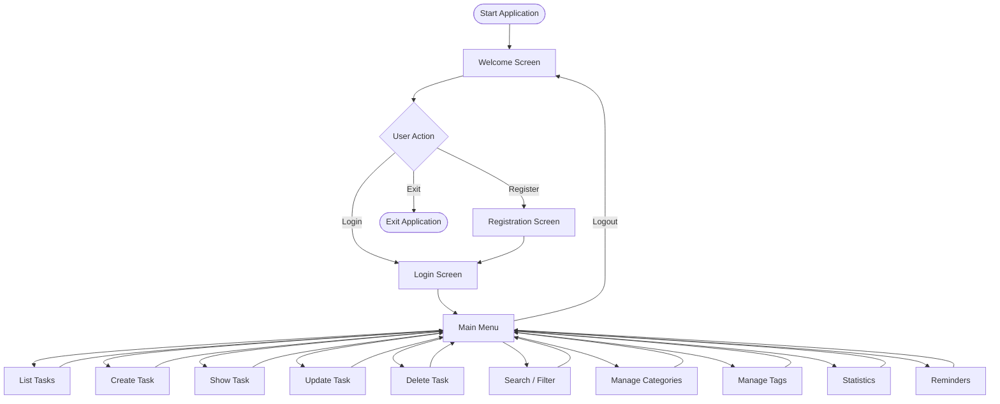

# UI Wireframe — Task Manager

**Project:** Task Manager  
**Version:** 1.0  
**Interface Type:** Command-Line Interface (CLI)  
**Status:** Proposed Design

---

## 1. Introduction

This document describes the initial user interface design of the Task Manager application.

The application uses a console-based interface. Users interact with the system through numbered menus, text inputs, and command-line messages.

The purpose of this wireframe is to define the main interaction flows, required user inputs, system responses, and error messages before implementing the presentation layer.

This document describes the proposed interface, not a fully implemented UI.

---

## 2. Application Navigation

The application follows this general navigation flow:



---

## 3. Welcome Screen

The welcome screen is displayed when the application starts.

### Wireframe

```text
========================================
             TASK MANAGER
========================================

Welcome!

1. Register
2. Login
0. Exit

----------------------------------------
Select an option: _
```

### User Input

- Menu option (1, 2, or 0).

### System Response

- Register: Opens the registration screen.
- Login: Opens the login screen.
- Exit: Terminates the application.

### Error Handling

```text
Invalid option.

Please select 1, 2, or 0.
```

---

## 4. Registration Screen

Allows a new user to create an account.

### Wireframe

```text
========================================
              REGISTER
========================================

Username: _
Password: ********
Confirm Password: ********

----------------------------------------
1. Create Account
0. Back

Select an option: _
```

### User Input

- Username
- Password
- Password confirmation

### System Response

Successful registration:

```text
----------------------------------------
Registration successful!

Your account has been created.
Please log in to continue.
----------------------------------------
```

### Error Scenarios

Username already exists:

```text
ERROR: Username already taken.
Please choose another username.
```

Passwords do not match:

```text
ERROR: Passwords do not match.
Please try again.
```

Invalid password length:

```text
ERROR: Password must contain at least
8 characters.
```

Empty username:

```text
ERROR: Username cannot be empty.
```

---

## 5. Login Screen

Allows registered users to access their task lists.

### Wireframe

```text
========================================
                LOGIN
========================================

Username: _
Password: ********

----------------------------------------
1. Login
0. Back

Select an option: _
```

### User Input

- Username
- Password

### System Response

Successful login:

```text
Login successful!

Welcome, alice.

Loading your tasks...
```

After login, the system opens the Main Menu and checks for due reminders.

### Error Scenario

```text
ERROR: Invalid username or password.

Please try again.
```

---

## 6. Main Menu

The main menu provides access to the application's primary features.

### Wireframe

```text
========================================
       TASK MANAGER - alice
========================================

1. List Tasks
2. Create Task
3. Show Task
4. Update Task
5. Delete Task
6. Search / Filter
7. Manage Categories
8. Manage Tags
9. Statistics
10. Reminders

11. Logout
0. Help

----------------------------------------
Select an option: _
```

### User Input

A numbered menu option.

### System Response

The application opens the selected feature.

After completing an operation, the user returns to the Main Menu.

---

## 7. List Tasks Screen

Displays all tasks belonging to the current user.

### Wireframe

```text
========================================
               MY TASKS
========================================

ID       TITLE              STATUS
----------------------------------------
T1001    Study Java         IN_PROGRESS
T1002    Write SRS          TODO
T1003    Network Homework   DONE

----------------------------------------
Total Tasks: 3

0. Back

Select an option: _
```

### User Input

- Back option.

### System Response

The system retrieves and displays the current user's tasks.

If no tasks exist:

```text
You have no tasks yet.

Select "Create Task" to add your first task.
```

---

## 8. Create Task Screen

Allows the user to create a new task.

### Wireframe

```text
========================================
              CREATE TASK
========================================

Title: _
Description: _
Due Date (YYYY-MM-DD, empty = none): _
Priority (LOW/MEDIUM/HIGH/URGENT): _
Category (empty = none): _
Tags (comma separated): _

----------------------------------------
Creating task...
```

### User Input

| Field | Required | Description |
|---|---|---|
| Title | Yes | Task title |
| Description | No | Additional details |
| Due Date | No | Task deadline |
| Priority | No | Task priority |
| Category | No | Assigned category |
| Tags | No | Comma-separated labels |

### System Response

```text
----------------------------------------
Task created successfully!

Task ID: T2001
Status: TODO
----------------------------------------
```

### Error Scenarios

Empty title:

```text
ERROR: Task title is required.
```

Invalid date:

```text
ERROR: Invalid date format.

Expected format: YYYY-MM-DD
```

Invalid priority:

```text
ERROR: Invalid priority.

Available values:
LOW, MEDIUM, HIGH, URGENT
```

---

## 9. Show Task Screen

Displays detailed information about a selected task.

### Wireframe

```text
========================================
              TASK DETAILS
========================================

Task ID: T2001
Title: Write Project Documentation

Description:
Initial project design documentation.

Status: TODO
Priority: HIGH
Due Date: 2026-11-25
Category: University
Tags: java, documentation

Created At: 2026-11-17
Completed At: N/A

----------------------------------------
0. Back

Enter Task ID: _
```

### User Input

- Task ID

### System Response

The system retrieves and displays the selected task.

### Error Scenario

```text
ERROR: Task not found.

Please enter a valid Task ID.
```

---

## 10. Update Task Screen

Allows the user to modify an existing task.

### Wireframe

```text
========================================
              UPDATE TASK
========================================

Enter Task ID: T2001

Current Title: Write Documentation
New Title: Complete Documentation

Current Priority: HIGH
New Priority: URGENT

Current Due Date: 2026-11-25
New Due Date: 2026-11-27

Update Description? (Y/N): Y
New Description: Final project documentation

----------------------------------------
1. Save Changes
0. Cancel

Select an option: _
```

### User Input

- Task ID
- Updated task attributes

### System Response

```text
Task updated successfully!

Task ID: T2001
```

### Error Scenario

```text
ERROR: Task not found.

No changes were made.
```

---

## 11. Delete Task Screen

Allows the user to delete an existing task.

### Wireframe

```text
========================================
              DELETE TASK
========================================

Enter Task ID: T2001

Task: Write Documentation
Status: TODO

Are you sure you want to delete
this task? (Y/N): _

```

### User Input

- Task ID
- Confirmation (Y/N)

### System Response

If confirmed:

```text
Task T2001 deleted successfully.
```

If cancelled:

```text
Operation cancelled.
No changes were made.
```

---

## 12. Change Task Status

Allows the user to update the status of a task.

### Wireframe

```text
========================================
          CHANGE TASK STATUS
========================================

Enter Task ID: T2001

Current Status: TODO

Available Statuses:

1. TODO
2. IN_PROGRESS
3. DONE
4. CANCELLED

Select New Status: _

----------------------------------------
```

### User Input

- Task ID
- New status

### System Response

```text
Task status updated successfully!

Task ID: T2001
New Status: DONE
```

When a task is marked as DONE, the system records its completion timestamp.

### Error Scenario

Illegal status transition:

```text
ERROR: Illegal status transition.

The requested status change is not allowed.
No changes were made.
```

---

## 13. Search / Filter / Sort Screen

Allows users to find and organize tasks.

### Wireframe

```text
========================================
          SEARCH AND FILTER
========================================

Search Keyword: _

Filter by Status:
TODO / IN_PROGRESS / DONE / CANCELLED

Filter by Priority:
LOW / MEDIUM / HIGH / URGENT

Filter by Category: _

Filter by Due Date:
1. Overdue
2. Due Today
3. Due This Week

Sort By:
1. Due Date
2. Priority
3. Creation Date
4. Title

Sort Order:
1. Ascending
2. Descending

----------------------------------------
1. Apply
0. Back

Select an option: _
```

### User Input

- Search keyword
- Filter criteria
- Sorting criteria

### System Response

The system displays tasks matching the selected criteria.

If no matching tasks exist:

```text
No tasks match your search criteria.
```

---

## 14. Manage Categories Screen

Allows users to organize tasks into categories.

### Wireframe

```text
========================================
           MANAGE CATEGORIES
========================================

1. List Categories
2. Create Category
3. Rename Category
4. Delete Category
0. Back

Select an option: _
```

### Create Category

```text
Category Name: _
Category Color: _

Category created successfully.
```

### Rename Category

```text
Category ID: C1001
New Category Name: University

Category renamed successfully.
```

### Delete Category

```text
Category ID: C1001

Are you sure? (Y/N): _
```

### Error Scenarios

```text
ERROR: Category name already exists.
```

```text
ERROR: Category not found.
```

---

## 15. Manage Tags Screen

Allows users to manage tags associated with their tasks.

### Wireframe

```text
========================================
              MANAGE TAGS
========================================

1. List Tags in Use
2. Add Tags to a Task
3. Remove Tags from a Task
0. Back

Select an option: _
```

### Add Tags

```text
Task ID: T2001
Tags (comma separated): java, university

Tags added successfully.
```

### Remove Tags

```text
Task ID: T2001
Tags to remove: university

Tags removed successfully.
```

---

## 16. Statistics Screen

Displays an overview of the user's task activity.

### Wireframe

```text
========================================
               STATISTICS
========================================

Total Tasks: 12

Tasks by Status:
TODO:        4
IN_PROGRESS: 3
DONE:        4
CANCELLED:   1

Overdue Tasks: 2

Completion Rate: 33.3%

----------------------------------------
0. Back
```

### System Response

The system calculates and displays task statistics based on the current user's data.

---

## 17. Reminders Screen

Displays overdue tasks and tasks due within the next 24 hours.

### Wireframe

```text
========================================
                REMINDERS
========================================

Overdue Tasks:

! T1001 - Finish Network Homework
  Due: 2026-11-15

Tasks Due Within 24 Hours:

T1002 - Submit Project Documentation
  Due: 2026-11-18

----------------------------------------
0. Back
```

### System Response

- Overdue tasks are marked with `!`.
- Tasks due within 24 hours are displayed.
- DONE and CANCELLED tasks are excluded.
- Tasks without a due date are excluded.

If no reminders exist:

```text
No upcoming or overdue tasks.
```

---

## 18. General Error Handling

The application should handle invalid input without terminating unexpectedly.

Examples:

| Situation | Expected Response |
|---|---|
| Invalid menu option | Display an invalid option message |
| Empty required field | Display a validation error |
| Invalid date format | Display expected date format |
| Invalid priority | Display available priorities |
| Unknown Task ID | Display Task not found |
| Illegal status transition | Display transition error |
| Storage failure | Display storage error |
| Invalid login credentials | Display authentication error |

After displaying an error, the application should allow the user to retry or return to the previous menu whenever appropriate.

---

## 19. Navigation and Interaction Rules

1. The user starts at the Welcome Screen.
2. Registration does not automatically log the user in.
3. Successful login opens the Main Menu.
4. The reminder check runs after login and at the beginning of each main-menu cycle.
5. Each completed operation returns the user to the Main Menu.
6. The user can return to the previous menu using the Back option.
7. Logout clears the current session and returns the user to the Welcome Screen.
8. Exit terminates the application.

---

## 20. Design Notes

- The interface is console-based and uses standard input/output.
- All menu options are selected using numeric input.
- Password input should be masked where terminal capabilities allow.
- Dates use the `YYYY-MM-DD` format.
- Optional fields can be left empty.
- Error messages should explain the problem and, when possible, how to correct it.
- This document represents the proposed UI design. The Presentation layer and its interaction flows will be implemented in a later development stage.
